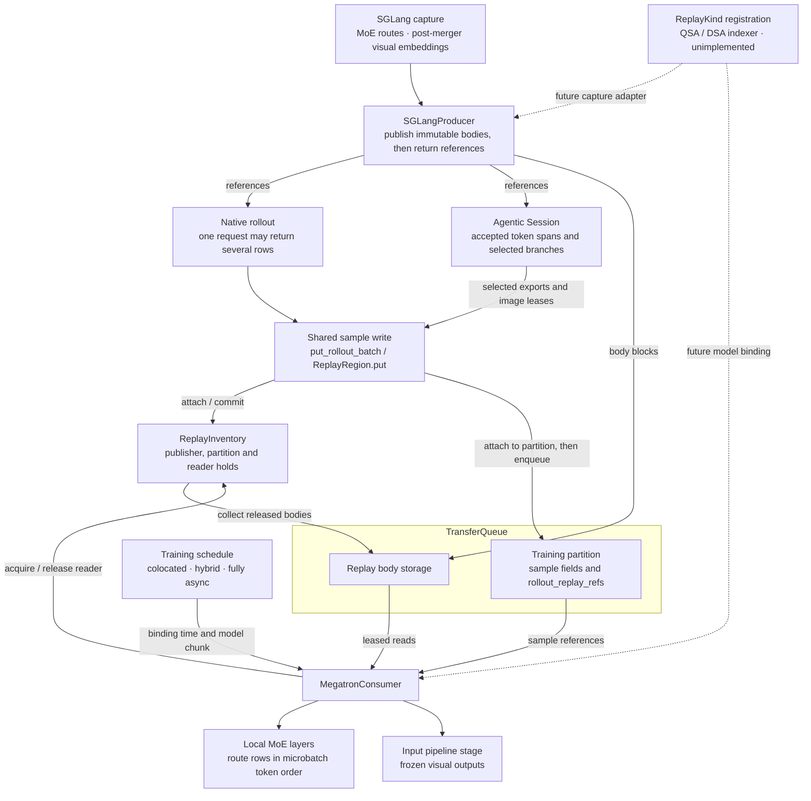

# Replay Manager

Replay Manager lets Megatron reuse the MoE expert routes and frozen visual embeddings that SGLang produced during rollout. The two built-in replay kinds are `moe` (R3) and `mm_embedding`. The diagram follows online **reference delivery** from one generation request to the training microbatch that consumes it. For offline reproduction of a training step, see [Trajectory Replay](./trajectory-replay.md).

## Architecture and ownership



SGLang captures expert IDs by token and layer, and captures visual embeddings after the vision merger. The producer publishes a reference once the body writes finish. A training sample carries its normal training fields and a compact replay manifest in `rollout_replay_refs`. Replay Manager tracks publisher ownership, partition holds and active readers so that retiring a training partition can reclaim bodies after the last holder releases them. Global recovery starts a new replay run.

**Sample selection.** Native rollout can export several training rows from a custom R3 generator. Rows from one request keep its sample index, and dropping one row releases only its share of a route. Default GRPO counts each request once and assigns its normalized reward to every row of that request. If those rows have different rewards, supply a `--custom-reward-post-process-path` to define how to process them. In Agentic rollout the Session determines which tokens were accepted and which branches enter training. Across turns or resumed requests it preserves the route spans for the accepted prefix. The manager transfers the selected route records and the lease for each selected image occurrence to the exported group. Rejected branches release their holdings.

**Queue handoff.** Both rollout paths use `put_rollout_batch`. Replay Manager attaches the selected bodies to the training partition before sending the samples. A failure known to precede dispatch releases the unsent holds. Once dispatch begins, a missing acknowledgement leaves the bodies available because a trainer may already see the samples. Acknowledged writes complete the handoff to the partition.

**Training schedule.** `MegatronConsumer` selects the queue fields and resolves the references. For R3, it maps the packed microbatch tokens to recorded rows for each local MoE layer. For MM, the input pipeline stage reads the frozen outputs and shares them within its tensor-parallel group.

| Schedule | When the consumer binds replay |
| --- | --- |
| Colocated | Prepare the routes and visual inputs before training from the collected batch. |
| Hybrid | Prepare R3 for the scheduled microbatches. After merging sub-batches, rebind the visual inputs to the merged batch. |
| Fully async | When the schedule fetches the actual microbatch, bind the routes for the current model chunk and the visual inputs where needed. MM has the PP restrictions below. |

### How reference R3 differs from the original path

1. **What travels with the sample.** The original SGLang rollout decoded the full route array into `Sample.rollout_routed_experts` and sent that field through the training queue. Reference R3 stores the immutable body separately. Multiple selected rows can refer to the same record, and each rank can read the rows for its own layers and token layout.
2. **Who decides when to replay and release.** The original Megatron Actor reshaped the queued arrays and filled router replay state itself. The training schedule now chooses the binding point, while Replay Manager owns the readers and the lifetime of the underlying records. This also gives Agentic branch selection and uncertain queue writes explicit ownership rules. The full-tensor R3 delivery path remains available in compatible configurations.

### Extension point for QSA and DSA indexer replay

The dotted edges show where a future indexer would capture its decisions and bind them to the consuming model. Register a `ReplayKind` with `ReplayManager.register_kind` before installing engine hooks. The definition names the replay field, producer and consumer adapters, and optional engine patch hooks. An indexer implementation must supply its capture format, token/layout validation and model-specific read and binding logic. **QSA and DSA indexer reference replay are unimplemented in this PR.** The separate draft explores the Qwen3.8 QSA and Keye DSA layouts. [Draft PR #730](https://github.com/redai-studio/Relax/pull/730)

## Enable R3 and MM replay

Add these flags to an online Megatron recipe:

```bash
--use-rollout-routing-replay
--use-routing-replay
--optimize-routing-replay
--use-rollout-mm-embedding-replay
--freeze-vision-model
--freeze-vision-projection
```

The first three flags control rollout route capture, training replay, and routing optimizations. Supported online R3 recipes default to references. When rollout dumps are enabled, the producer copies MoE routes before sending the batch to training so the dump remains readable after partition cleanup. MM embedding references are local to the run. Baselines remove the four replay flags while keeping the vision encoder and projection frozen.

MM supports Qwen3.5 MoE and multimodal Qwen3.8 checkpoints with visual widths of 2048 and 2560 respectively, spatial merge size 2, and no DeepStack. It requires BF16, packed THD, CP1, and frozen vision encoder and merger/projection. Colocated, hybrid, and fully async modes support built-in SGLang and Agentic rollout. Asynchronous MM requires PP1 without interleaving; fully async additionally requires dynamic token batching and inline actor log-probabilities, without a separate reference policy. MM does not support Critic, partial rollout, MTP, speculative decoding, hierarchical cache, custom generation, Slime router, or OPD.

Capture occurs after the visual merger. Training loads BF16 outputs on the input PP stage and broadcasts within the TP group, without quantization. Reference R3 requires static CP and excludes combined 1F1B MoE overlap. Use an image with matching SGLang and Megatron patches; these experiments used SGLang 0.5.21.

## Split-branch experiment record (2026-11-22)

Model: **Qwen3.5-35B-A3B**. Each experiment uses **8 × 280G Blackwell GPUs on one node**. Replay is **R3+MM reference**, without QSA/DSA. Each run has 10 steps and saves no model checkpoint. Values below are arithmetic means over steps 1–9, excluding step 0. Rewards are omitted.

| Task / mode | Baseline s/step | Replay s/step | Time change | Mismatch KL: baseline → replay | Status |
| --- | ---: | ---: | ---: | --- | --- |
| DeepEyes fully async, TQ fixed | 70.98 | 62.72 | −11.6%* | 0.003724 → 0.000825 | Both completed 10 steps |
| DeepEyes hybrid | 69.61 | 68.55 | −1.5% | 0.004220 → 0.001261 | Both completed 10 steps |
| DeepEyes colocated | 124.03 | 121.57 | −2.0%† | 0.003942 → 0.000634 | Replay completed 10 steps |
| OpenR1MM colocated | 129.71 | 119.80 | −7.6% | 0.001488 → 0.000296 | Both completed 10 steps |

\* Fully async is a diagnostic comparison across two machines, each using eight GPUs independently, with an additional sealer change. Its timing difference cannot be attributed entirely to replay. The current-branch confirmation without that change or profiling also completed 10 steps: **59.09 s/step, mismatch KL 0.001119**. It is recorded separately rather than mixed into this pair.

† DeepEyes colocated uses a historical baseline. Hybrid OFF/ON ran on the same machine. Trajectory lengths and token counts vary during these short runs.

### Key configuration

| Setting | DeepEyes fully async / hybrid | DeepEyes / OpenR1MM colocated |
| --- | --- | --- |
| GPU allocation | Actor 4 + Rollout 4, separate GPUs | Actor and Rollout time-share 8 GPUs |
| Training TP / PP / CP / EP / ETP | 2 / 1 / 1 / 4 / 1 | 2 / 1 / 1 / 8 / 1 |
| Sequence parallel | Enabled | Enabled |
| Rollout engines | 2 engines, TP2 each | 4 engines, TP2 each |
| Staleness | 2 | 0 |
| Prompt batch × samples per prompt | 16 × 8 | 16 × 8 |
| Global batch size | 128 | 128 |
| Micro batch / dynamic token budget | micro-batch-size=1; dynamic batching, max-tokens-per-gpu=16384 | Same |
| Prompt / response / context limits | 4096 / 2048 / 16384 tokens | Same |
| SGLang context / max running / max total tokens | 16384 / 32 / 131072 per engine | Same |
| SGLang static memory fraction | 0.75 | 0.75 |
| Precision / attention | BF16 / Flash | BF16 / Flash |
| Vision model / projection | Both frozen | Both frozen |
| Optimizer | Adam, lr=1e-6; CPU offload, D2H/H2D overlap, precision-aware optimizer enabled | Same |
| Algorithm | GRPO + TIS, mismatch metrics enabled | Same |

DeepEyes uses agentic concurrency 8 and timeout 1200 seconds, with a separate CPU Qwen2.5-1.5B-Instruct judge on each node. OpenR1MM uses the built-in `openr1mm` reward path without agentic rollout. Communication uses Socket + IPv4 with IB, network plugins, and NVLS disabled; all experiments are single-node.

For a runnable colocated R3 example, see the [OpenR1MM training script](../../../scripts/training/multimodal/run-qwen35-35B-A3B-8xgpu-openr1mm-r3.sh).
