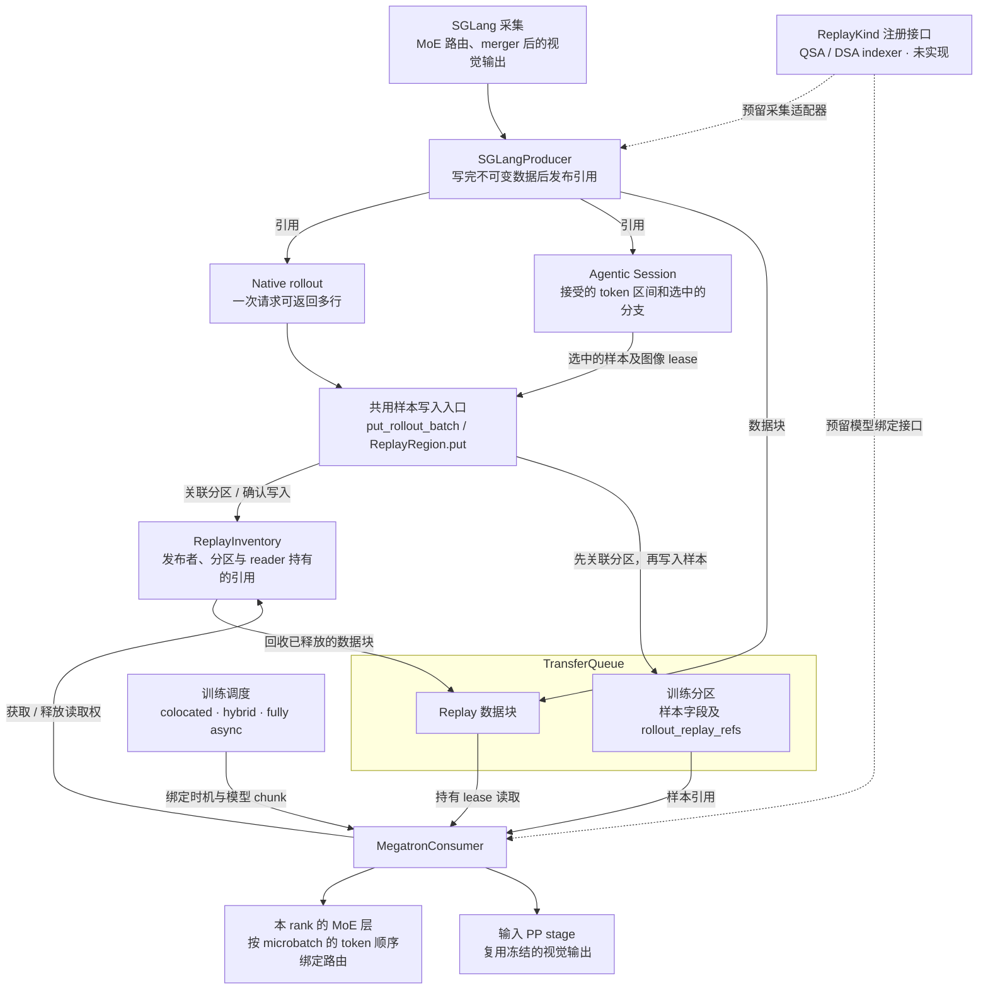

# Replay Manager

Replay Manager 让 Megatron 在训练时复用 SGLang 在 rollout 中产生的 MoE 专家路由和冻结视觉模型的 embedding。当前内置两种 replay 类型：`moe`（R3）和 `mm_embedding`。下图沿在线 **reference 模式** 展示一次生成请求的数据如何进入实际消费它的训练 microbatch。离线复现训练步骤见[轨迹重放](./trajectory-replay.md)。

## 架构与所有权



SGLang 按 token 和层采集专家编号，在视觉 merger 之后采集 embedding。生产端等数据块写完再发布引用。训练样本保留常规训练字段，replay 数据通过 `rollout_replay_refs` 中的描述符传递。Replay Manager 跟踪发布者、训练分区和活跃 reader 各自持有的引用。分区退役后，仍在读取的数据会保留到最后一个持有者释放。全局恢复会创建新的 replay run。

**样本选择。** Native rollout 的自定义 R3 生成器可以为一次请求导出多行，各行沿用原请求的 sample index。丢弃一行只释放该行持有的路由。默认 GRPO 对同一请求的奖励只计一次，并将归一化结果用于该请求的每一行。若各行奖励不同，用 `--custom-reward-post-process-path` 指定处理方式。Agentic rollout 由 Session 决定接受哪些 token、哪些分支进入训练。多轮生成或中断续跑时，已接受的前缀沿用原来的路由区间。Replay Manager 据此把选中的路由记录和每次图像引用各自的 lease 移交给导出的 Group，回收被丢弃分支持有的数据。

**写入训练队列。** 两条 rollout 路径共用 `put_rollout_batch`。Replay Manager 先把选中的数据关联到训练分区，再发送样本。确定在发送前失败时，释放未发送样本持有的引用。一旦开始发送，即使收不到 ACK，也会保留数据，因为训练端可能已经看到了样本。收到 ACK 后完成向分区的移交。

**训练调度。** `MegatronConsumer` 选择队列字段并解析引用。R3 按 packed microbatch 的 token 布局，为本 rank 上各个 MoE 层映射路由行。MM 由输入 PP stage 读取冻结的视觉输出，并在 TP 组内共享。

| 调度模式 | consumer 在何时绑定数据 |
| --- | --- |
| Colocated | 收齐 batch 后，在训练前准备路由和视觉输入。 |
| Hybrid | 按已排定的 microbatch 准备 R3。子批次合并后，只需把视觉输入重新绑定到合并后的 batch。 |
| Fully async | 调度器取到实际 microbatch 时，绑定当前模型 chunk 的路由，并在需要时绑定视觉输入。MM 的 PP 限制见下文。 |

### 相比原有 R3 路径的两处变化

1. **样本携带的数据。** 原来的 SGLang rollout 将完整路由数组解码到 `Sample.rollout_routed_experts`，再把该字段写进训练队列。Reference R3 单独存放不可变数据。多行样本可以共享一条记录，各 rank 按本地层和 token 布局读取所需的路由行。
2. **绑定时机和释放责任。** 原先由 Megatron Actor 重排队列中的数组并填充 router replay 状态。现在训练调度决定何时绑定，Replay Manager 管理 reader 和底层记录的生命周期。Agentic 分支取舍、队列写入结果未知时的引用归属也有了明确的处理路径。兼容配置仍可使用 R3 全量张量传递模式。

### QSA / DSA indexer replay 的扩展位置

图中虚线标出了未来 indexer 的决策采集和模型绑定位置。各参与进程在安装引擎 hook 前，通过 `ReplayManager.register_kind` 注册 `ReplayKind`，指定 replay 字段、生产端和消费端适配器，以及可选的引擎 patch hook。接入方还需实现 indexer 的采集格式、token 与布局校验、面向具体模型的读取和绑定逻辑。**本 PR 未实现 QSA 或 DSA 的 indexer 引用回放。** Qwen3.8 QSA 和 Keye DSA 的布局设计见独立的 [Draft PR #730](https://github.com/redai-studio/Relax/pull/730)。

## 开启 R3 与 MM replay

在线 Megatron 配方中加入：

```bash
--use-rollout-routing-replay
--use-routing-replay
--optimize-routing-replay
--use-rollout-mm-embedding-replay
--freeze-vision-model
--freeze-vision-projection
```

R3 的前三个开关分别控制 rollout 采集、训练重放与路由优化。支持的在线 R3 配方默认使用 reference，MM replay 也使用 reference。关闭 replay 的基线移除四个 replay 开关，仍冻结视觉模型和 projection。

MM 支持 Qwen3.5 MoE 和 Qwen3.8 多模态 checkpoint，分别要求 2048 和 2560 维视觉输出、spatial merge size 2、无 DeepStack。要求 BF16、packed THD、CP1，同时冻结视觉编码器和 merger/projection。支持内置 SGLang 与 Agentic rollout 的 colocated、hybrid、fully async；异步 MM 要求 PP1、无 interleaving，fully async 还要求动态 token batching、inline actor log-probability，且不使用独立 reference policy。Critic、partial rollout、MTP、推测解码、hierarchical cache、自定义生成、Slime router 和 OPD 不在 MM 支持范围。

采集发生在视觉 merger 之后，训练在输入 PP stage 读取并向 TP 组广播，复用 BF16 视觉输出，不做量化。R3 reference 要求静态 CP，关闭 combined 1F1B MoE overlap。需要带匹配 SGLang 和 Megatron patch 的镜像；本轮实验使用 SGLang 0.5.21。

启用 rollout 调试转储后，生产端会在向训练发送样本前复制 MoE 路由，分区清理后仍可读取转储。MM embedding 引用只在当前作业有效。

## DAPO-Math 50k 对比结果（2026-11-23）

三组实验使用相同模型、数据和并行配置，每组完成 1 个优化器步。所有样本均实际生成 50,000 token，MM replay 关闭。

| 参数 | 配置 |
| --- | --- |
| 模型 / 数据 | Qwen3.5-35B-A3B / DAPO-Math-17k |
| 硬件 / 模式 | 2 机 16 张 Blackwell GPU，Actor 与 rollout 共卡 |
| 训练 TP / PP / CP / EP / ETP | 2 / 1 / 2 / 8 / 1 |
| Rollout | 8 个 TP2 引擎，每引擎最多 16 个请求 |
| Prompt 数 × 每题采样数 / GBS | 32 × 16 / 512 |
| Micro-batch / 每卡动态 token 预算 | 1 / 65,536 |
| 回复长度 / Context 上限 | 50,000 / 65,536 token |
| MTP | NEXTN，draft steps=2，draft tokens=3，top-k=1 |
| 精度 / 优化器 | BF16 / Adam，lr=1e-6，CPU offload |
| 每组总输出 | 25,600,000 token |

| 配置 | 端到端秒 | 训练秒 | 相对基线的端到端耗时 | Mismatch KL | R3 前台等待秒 | 状态 |
| --- | ---: | ---: | ---: | ---: | ---: | --- |
| R3 关闭 | 1382 | 501.16 | — | 0.000701 | — | 完成 |
| R3 uint8 | 1595 | 674.42 | +15.4% | 0.000491 | 117.76 | 完成 |
| R3 uint8 + CPU 缓存回收与逐层预取 | 1445 | 522.06 | +4.6% | 0.000494 | 0.048 | 完成 |

端到端时间从 rollout 开始计至该步训练数据清理完成，包含 checkpoint 保存和最终权重同步。训练时间为 `perf/train_time`，R3 前台等待为 `perf/replay_consumer_wait_time`。调整后的训练时间比关闭 R3 增加 4.2%，mismatch KL 降低 29.6%。每组只有一个完整步骤。

## 拆分分支实验记录（2026-11-22）

模型为 **Qwen3.5-35B-A3B**，每个实验独立使用单机 **8 张 280G Blackwell GPU**。Replay 为 **R3+MM reference**，不开 QSA/DSA。每组 10 步，不保存模型；下表为剔除 step 0 后 step 1–9 的算术均值，不报告 reward。

| 任务 / 模式 | 基线 秒/步 | Replay 秒/步 | 耗时变化 | Mismatch KL：基线 → Replay | 状态 |
| --- | ---: | ---: | ---: | --- | --- |
| DeepEyes fully async，TQ 修复后 | 70.98 | 62.72 | −11.6%* | 0.003724 → 0.000825 | 两组均完成 10 步 |
| DeepEyes hybrid | 69.61 | 68.55 | −1.5% | 0.004220 → 0.001261 | 两组均完成 10 步 |
| DeepEyes colocated | 124.03 | 121.57 | −2.0%† | 0.003942 → 0.000634 | Replay 完成 10 步 |
| OpenR1MM colocated | 129.71 | 119.80 | −7.6% | 0.001488 → 0.000296 | 两组均完成 10 步 |

\* Fully async 为两台机器各自单机 8 卡的诊断对照，使用含额外 sealer 调整的代码，不能将耗时差全部归因于 replay。当前分支无额外 sealer 调整、无 profiler 的确认实验也已完成 10 步：**59.09 秒/步，mismatch KL 0.001119**，单独记录，不混入该对照。

† DeepEyes colocated 使用历史基线。Hybrid OFF/ON 在同一机器运行。短跑中的轨迹长度和 token 数会变化。

### 关键配置

| 配置 | DeepEyes fully async / hybrid | DeepEyes / OpenR1MM colocated |
| --- | --- | --- |
| GPU 分配 | Actor 4 卡 + Rollout 4 卡，独立 GPU | Actor、Rollout 分时共用 8 卡 |
| 训练 TP / PP / CP / EP / ETP | 2 / 1 / 1 / 4 / 1 | 2 / 1 / 1 / 8 / 1 |
| Sequence parallel | 开 | 开 |
| Rollout 引擎 | 2 个引擎，各 TP2 | 4 个引擎，各 TP2 |
| Staleness | 2 | 0 |
| Prompt batch × 每题采样数 | 16 × 8 | 16 × 8 |
| Global batch size | 128 | 128 |
| Micro batch / 动态 token 预算 | micro-batch-size=1；开启动态 batching，max-tokens-per-gpu=16384 | 同左 |
| Prompt / Response / Context 上限 | 4096 / 2048 / 16384 token | 同左 |
| SGLang context / max running / max total tokens | 16384 / 32 / 131072（每引擎） | 同左 |
| SGLang 静态显存比例 | 0.75 | 0.75 |
| 精度 / Attention | BF16 / Flash | BF16 / Flash |
| 视觉模型 / Projection | 均冻结 | 均冻结 |
| 优化器 | Adam，lr=1e-6，CPU offload、D2H/H2D overlap、precision-aware optimizer 均开启 | 同左 |
| 算法 | GRPO + TIS，记录 mismatch | 同左 |

DeepEyes agentic concurrency=8，timeout=1200 秒，judge 为各机独立 CPU Qwen2.5-1.5B-Instruct。OpenR1MM 使用内置 `openr1mm` reward 路径，无 agentic rollout。通信环境统一为 Socket + IPv4，关闭 IB、网络插件和 NVLS；各实验本身均为单机。

Colocated R3 的启动示例见 [OpenR1MM 训练脚本](../../../scripts/training/multimodal/run-qwen35-35B-A3B-8xgpu-openr1mm-r3.sh)。
