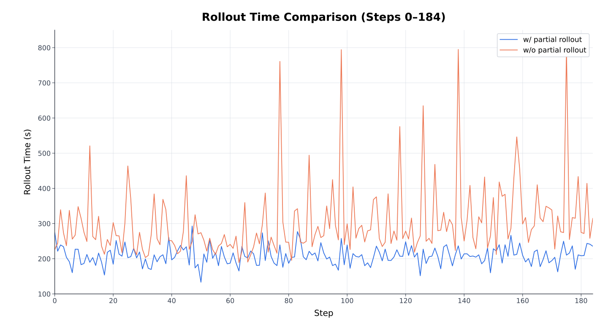
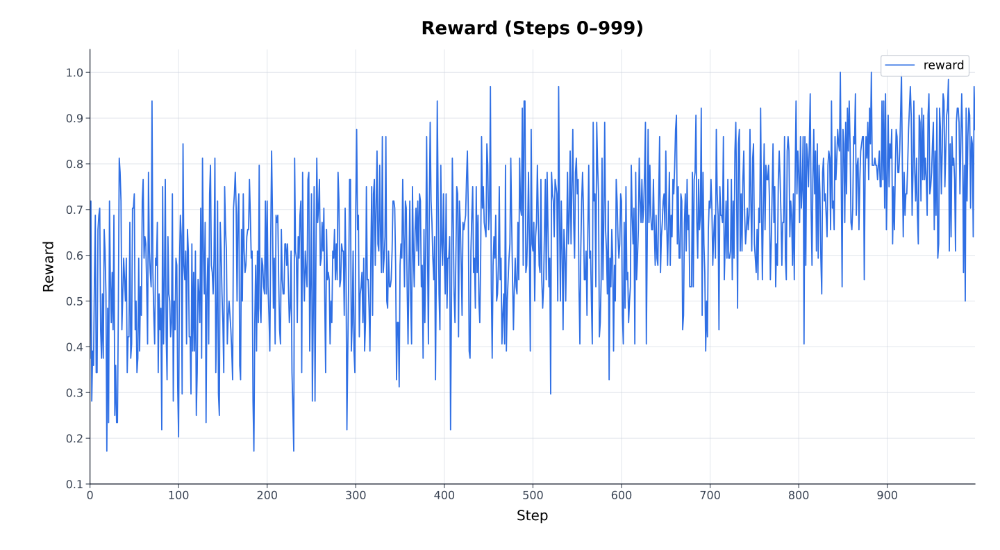

# Codex/R2E-Gym

Run the official Codex CLI on R2E-Gym tasks through Relax's HTTP Responses API. Choose a rollout mode before preparing the environment:

- **Direct (Recommended):** Codex sends its growing full history directly to Relax. The Session exports one append-only training context. Reaching the context limit ends the agent, and the verifier scores the current workspace.
- **Compaction (Experimental):** Codex summarizes accumulated history after reaching the compaction threshold. Later turns continue from the summary in a new append-only context. A transparent proxy exports the summary-generation context and each resumed task context with one shared Session advantage.

> **Warning:** Compaction is experimental and has not yet been validated in a long-running training experiment.



## Prerequisites

Complete these steps on a Relax cluster with the Qwen3.5-35B-A3B model available. Every agent node needs `uv`, `apptainer`, and the Codex agent environment at the same absolute path. Paths used by Ray workers must be accessible from every agent node.

On hosts that do not run systemd as PID 1, configure Apptainer to use cgroupfs before training:

```bash
apptainer config global --set "systemd cgroups" no
```

## 1. Prepare the agent environment

Run the following commands on every agent node. The venv reuses the packages from the Relax environment while keeping agent-specific installs isolated.

```bash
export CODEX_AGENT_VENV=/opt/codex-r2e-venv

uv venv "${CODEX_AGENT_VENV}" --python 3.12 --system-site-packages

# Required for Eval
uv pip install --python "${CODEX_AGENT_VENV}/bin/python" swebench
```

## 2. Install Codex

Download the prebuilt x86_64 Linux binary to a shared directory:

```bash
export CODEX_RUNTIME_DIR=/path/to/codex-runtime
export CODEX_VERSION=0.156.1

mkdir -p "${CODEX_RUNTIME_DIR}"
curl -fsSL \
  "https://github.com/openai/codex/releases/download/rust-v${CODEX_VERSION}/codex-x86_64-unknown-linux-musl.tar.gz" \
  -o /tmp/codex.tar.gz
tar -xzf /tmp/codex.tar.gz -C "${CODEX_RUNTIME_DIR}"
mv "${CODEX_RUNTIME_DIR}/codex-x86_64-unknown-linux-musl" "${CODEX_RUNTIME_DIR}/codex"
rm /tmp/codex.tar.gz
```

## 3. Prepare R2E-Gym assets

This recipe uses the same parquet files, offline wheel, and SIF images as `examples/mini_swe_agent`:

```text
${R2E_DATA_PATH}/
├── R2E-Gym-Lite/data/train-*.parquet
├── SWE-Bench-Lite/data/test-*.parquet
└── wheels/chardet-5.2.0-*.whl
${R2E_SIF_DIR}/*.sif
```

Export the asset paths and create a small environment for data preparation:

```bash
export R2E_DATA_PATH=/path/to/r2e
export R2E_SIF_DIR=/path/to/r2e/sifs
export R2E_SETUP_VENV=/path/to/r2e-setup-venv

uv venv "${R2E_SETUP_VENV}"
uv pip install --python "${R2E_SETUP_VENV}/bin/python" pyarrow huggingface_hub
```

If you previously ran the data preparation in `examples/mini_swe_agent`, continue to prompt data preparation. The datasets, wheel, and SIF images do not need to be downloaded or built again.

For a new asset setup, run the shared script:

```bash
MINI_SWE_AGENT_VENV="${R2E_SETUP_VENV}" \
  R2E_DATA_PATH="${R2E_DATA_PATH}" \
  R2E_SIF_DIR="${R2E_SIF_DIR}" \
  bash examples/mini_swe_agent/setup_r2e_data_and_sifs.sh
```

The shared script downloads both datasets and the offline wheel, then builds missing SIF images. Codex prompt data is prepared in the next step.

## 4. Prepare prompt data

Convert the R2E-Gym training split with the setup environment that contains `pyarrow`:

```bash
export CODEX_R2E_DATA=/path/to/r2e/codex_r2e_train.jsonl

"${R2E_SETUP_VENV}/bin/python" examples/codex/r2e_gym/prepare_data.py \
  --data-dir "${R2E_DATA_PATH}/R2E-Gym-Lite/data" \
  --sif-dir "${R2E_SIF_DIR}" \
  --output "${CODEX_R2E_DATA}"
```

The converter stores `problem_statement` as one user message under the dataset key `input`. Relax reads that key through `--input-key input` and passes the normalized `messages` to the agent:

```json
{"input":[{"role":"user","content":"..."}],"metadata":{"r2e":{"docker_image":"...","expected_output_json":"..."}}}
```

Evaluation is optional. Convert the SWE-Bench Lite split when evaluation is needed:

```bash
export CODEX_EVAL_DATA=/path/to/r2e/codex_swe_bench_lite_eval.jsonl

"${R2E_SETUP_VENV}/bin/python" examples/codex/r2e_gym/prepare_data.py --split eval \
  --data-dir "${R2E_DATA_PATH}/SWE-Bench-Lite/data" \
  --sif-dir "${R2E_SIF_DIR}" \
  --output "${CODEX_EVAL_DATA}"
```

Setting `CODEX_EVAL_DATA` enables evaluation before training and at the configured interval.

## 5. Configure the run

Export the paths used by the launcher:

```bash
export MODEL_DIR=/path/to/models
export CODEX_AGENT_PYTHON=/opt/codex-r2e-venv/bin/python
export R2E_DATA_PATH=/path/to/r2e
export R2E_SIF_DIR=/path/to/r2e/sifs
export CODEX_RUNTIME_DIR=/path/to/codex-runtime
export CODEX_R2E_DATA=/path/to/r2e/codex_r2e_train.jsonl
export EXP_ROOT=/path/to/experiments/codex-r2e

# Optional evaluation dataset
export CODEX_EVAL_DATA=/path/to/r2e/codex_swe_bench_lite_eval.jsonl
```

Omit `CODEX_EVAL_DATA` when evaluation is not required.

## 6. Launch training

> **Warning:** Every launch automatically applies the resource limits defined in `examples/codex/r2e_gym/config.yaml`: `memory: 4G`, `memory_swap: 4G`, and `pids_limit: 512`. `examples/codex/r2e_gym/agent.py` passes them to `apptainer exec` as `--memory 4G`, `--memory-swap 4G`, and `--pids-limit 512`. These limits cover Codex and the Bash commands and child processes it launches, protecting the host from runaway agent workloads.

Direct mode is the established training path:

```bash
bash examples/codex/r2e_gym/run_codex_r2e.sh
```

To try experimental compaction, set its context window and threshold:

```bash
CODEX_CONTEXT_WINDOW=32768 CODEX_COMPACT_LIMIT=16384 \
  bash examples/codex/r2e_gym/run_codex_r2e_compact.sh
```

Both launchers write rollout dumps to `${EXP_ROOT}/dump`, run the verifier after Codex exits, and disable checkpoint saving.

## Direct-mode Results

Both plots come from Direct-mode runs.

Partial rollout kept rollout time within a narrower range in the comparison window and avoided the large latency spikes seen without it.



Raw reward shows a clear upward trend throughout training.


