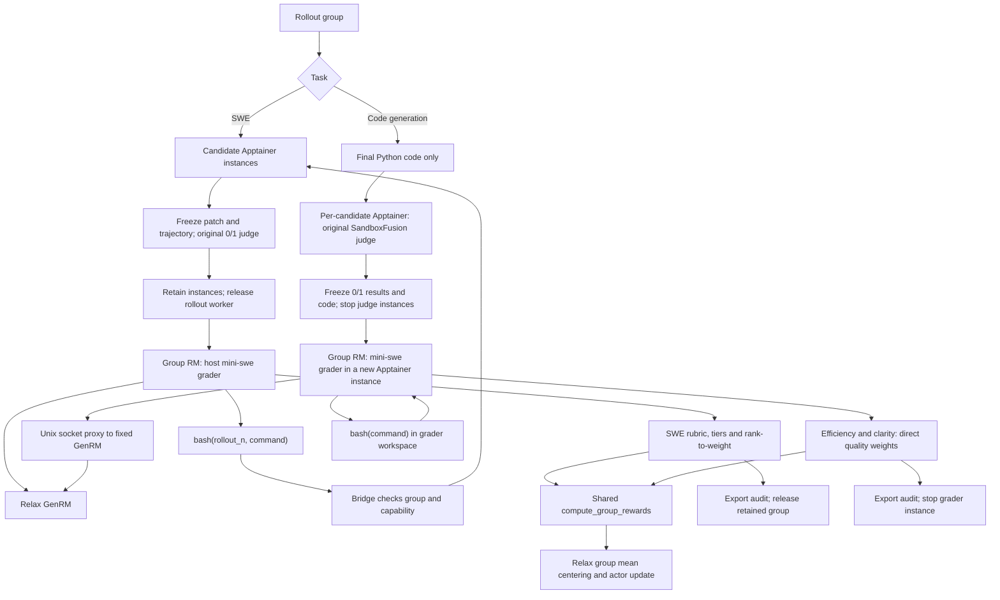

# Agentic grader — Draft demo

The integration is contained in `examples/gagar`. Each task owns its environment and scoring adapter. Root launch scripts and
`grader.yaml` select the task and its configuration. `app/runner.py` uses process replacement
to preserve the PID tracked by existing leases and cancellation. Only the arithmetic, reward record
format and mini-swe grader loop are shared. No core GenRM or other recipe changes
are required.

| Task            | Entry point                                  | Model commands                            | Configuration                        |
| --------------- | -------------------------------------------- | ----------------------------------------- | ------------------------------------ |
| Code generation | [run_code_generate.sh](run_code_generate.sh) | `bash(command)` in the grader sandbox     | `grader.yaml`: `tasks.code_generate` |
| SWE             | [run_minisweagent.sh](run_minisweagent.sh)   | `bash(rollout_n, command)` via the bridge | `grader.yaml`: `tasks.minisweagent`  |

Code generation also includes its [0/1 baseline](app/code_generate/BASELINE.md).
The SWE directory contains the GAGAR version only, including its own server and
on-demand SIF cache. It preserves original train/eval judging and lifecycle safeguards.

Code generation enters through `app/code_generate/group_rm.py`, which supervises
the separate `sandbox/worker.py` worker. SWE enters through `app/minisweagent/group_rm.py`
and asks the bridge to run the grader against retained candidate environments.
Both entry points return the shared reward records without changing the original
outcome judging or sandbox cleanup rules.

Setup and launch details: [code generation](app/code_generate/README.md) ·
[SWE](app/minisweagent/README.md).

## Execution flow

`core/grs.py` owns the agent loop and the shared `read_evidence` /
`submit_grades` dispatch. Each task composes it with its own bash executor,
scoring function. Evidence sections, prompts, budgets and environment parameters
come from the shared `grader.yaml`.

Only task-specific bash adapters execute commands. Both graders reuse the group RM and agent loop, then feed aligned quality weights into the same arithmetic. Their scoring rubrics are intentionally different.

## Recorded execution

Historical SWE and code-generation animations and review notes are kept in
[PR #446](https://github.com/redai-studio/Relax/pull/446). They replay recorded runs,
not a live terminal or a rerun of this branch.

## Shared model messages

`core/grs.py` sends complete `role/content` histories to the existing GenRM
endpoint. When thinking is enabled, the assistant content contains its reasoning
inside `<think>...</think>`, followed by the tool action. The parser executes only
the final action. The code-generation Qwen configuration sets
`preserve_thinking=false` to prevent a second template-generated wrapper.
Malformed/incomplete output still follows format feedback and the existing budget;
there is no constrained JSON decoding.

The replay demonstrates execution and scoring evidence, not a convergence advantage.

## Layout and grader entry point

`core/gar.py` owns the pure reward conversion and reward records.
`core/grs.py` owns the mini-swe-agent loop and the `execute` / `close` backend
interface. Task adapters and sandbox implementations live in `app/`.
`run_grs.sh --task code_generate|minisweagent --input INPUT --output OUTPUT`
uses `MINI_SWE_AGENT_VENV` and the YAML entrypoint. Code generation accepts
the group worker input (task, labels, responses and GenRM URL), provisions its
containers and runs the shared grader inside. SWE accepts a retained-group
manifest and attaches to its bridge.
The code-generation worker invokes the same Python entry point inside its
container; SWE invokes it with a bridge connection. The original worker and
bridge continue to own provisioning, cancellation and final sandbox cleanup.

## Unified configuration

`grader.yaml` contains common agent and command budgets plus task-specific
model settings, GenRM engine/sampling settings, environment adapters, evidence
sections, system templates and instance templates. Jinja variables such as
`{{ task }}` remain supported inside YAML block strings. There are no separate
instance template files. `app/config.py` resolves task settings without importing
mini-swe-agent into the training process.

Use `GAGAR_CONFIG=/absolute/path/grader.yaml` for both training launchers, for training and `run_grs.sh` sessions. The underlying shared grader also
accepts `--config FILE` when invoked directly. The code-generation worker carries the resolved task config
into its isolated container. Existing node-path and SWE lease environment
overrides retain precedence. Original rollout/harness configuration and image
build files remain inside the task's sandbox implementation.
