# Kimi K3 Training and Export

[中文](./README.zh-CN.md)

## Overview

Relax provides full-parameter and LoRA SFT for Kimi K3, with image inputs, packing, fixed CP, PP and EP. The model configuration is `scripts/models/kimi-k3.sh`; public recipes live in `examples/models/kimi-k3/scripts/`.

Use a training image built with the pinned Megatron/Bridge, FLA and NVRx dependencies in `docker/Dockerfile` or `docker/Dockerfile.cu13`. Model and dataset directories must be readable from every training node. These recipes are reference configurations; validate memory use and numerical behavior on the target cluster before a long run.

## Open-Data Reproduction Results

The following Kimi K3 runs use HellaSwag, multimodal-open-r1-8k-verified (OpenR1-MM), Pokémon captions and LLaVA-OneVision v1.5 Instruct. Measurements below were collected on 128×280G Blackwell GPUs for full-parameter SFT/GRPO and 64×280G Blackwell GPUs for LoRA. They describe those experiment configurations; current recipe defaults may differ. Curves show raw steps with smoothing 0.25 and the unsmoothed trace in the background.

| Dataset                       | Experiment                      | Observed result                                                                                                   |
| ----------------------------- | ------------------------------- | ----------------------------------------------------------------------------------------------------------------- |
| HellaSwag                     | Raw context/target SFT          | Training loss settles around 1.4 over 100 steps; validation loss decreases to about 1.93.                         |
| OpenR1-MM                     | Full-parameter multimodal SFT   | Exported MXFP4 checkpoint improves pass@k on a 256-example held-out split; detailed scoring below.                |
| Pokémon captions (Chinese)    | Language-backbone LoRA          | Training loss decreases through step 198.                                                                         |
| LLaVA-OneVision v1.5 Instruct | Long-context SFT, frozen vision | Recorded through step 680; packed sequences around 110k tokens and step time around 60 s, with occasional spikes. |
| OpenR1-MM                     | Multimodal GRPO                 | Rollout reward increases; train/rollout logprob differences remain small and decrease during the illustrated run. |

### HellaSwag SFT

The raw-text recipe supervises the target ending from the original context. These are language-model loss measurements, not HellaSwag multiple-choice accuracy. The recorded training step time was approximately 40 s on 128×280G Blackwell.

|                      Training loss                      |                        Validation loss                         |
| :-----------------------------------------------------: | :------------------------------------------------------------: |
| 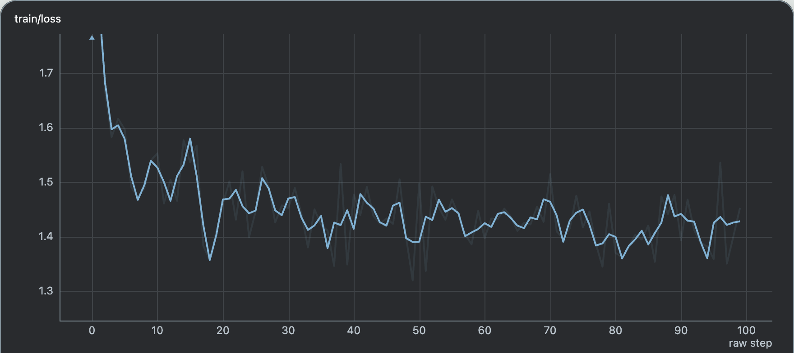 | 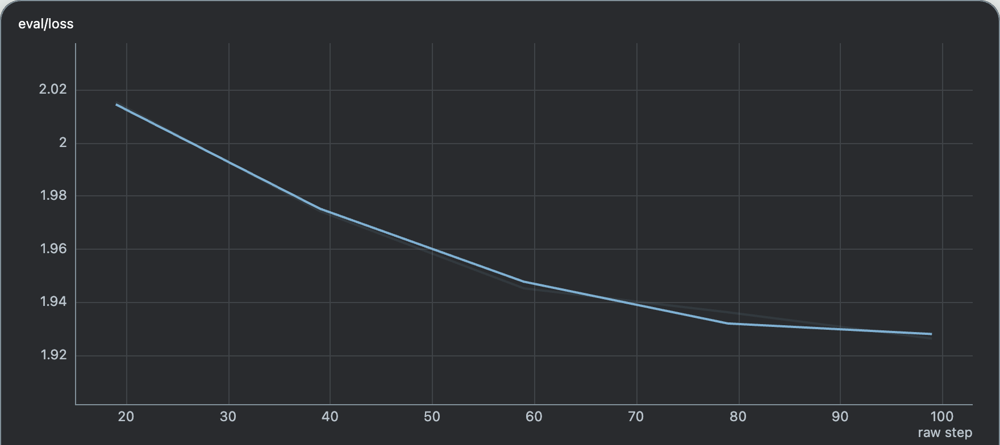 |

Recipe: [`run-kimi-k3-hellaswag-128xblackwell-rawtext.sh`](./scripts/run-kimi-k3-hellaswag-128xblackwell-rawtext.sh).

### OpenR1-MM SFT and Evaluation

The SFT experiment uses 7424 training examples and 256 held-out evaluation examples from multimodal-open-r1-8k-verified. Evaluation compares the original Kimi K3 weights with SFT checkpoint **iter86 after export to native MXFP4 HF weights**.

| Scoring rule                               | Model            |     pass@1 |     pass@4 |     pass@8 |    pass@16 |
| ------------------------------------------ | ---------------- | ---------: | ---------: | ---------: | ---------: |
| Original OpenR1-MM reward: format + answer | Original Kimi K3 |      7.50% |     11.92% |     14.98% |     20.00% |
| Original OpenR1-MM reward: format + answer | SFT iter86       | **66.25%** | **77.64%** | **84.00%** | **90.00%** |
| Final-answer scorer v2                     | Original Kimi K3 |     43.44% |     49.31% |     52.29% |     55.00% |
| Final-answer scorer v2                     | SFT iter86       | **56.25%** | **64.84%** | **70.10%** | **75.00%** |

These are two separate scoring implementations; their scores are not nested and should only be compared within the same rule. This is a held-out split of the SFT dataset, not an independent benchmark suite. The recorded summary does not specify all decoding settings, so these values should not be treated as a fully specified evaluation protocol. The current [`eval_openr1mm.py`](../../../scripts/tools/eval_openr1mm.py) provides a final-answer evaluator; its defaults do not establish the historical settings.

|                         Representative SFT training-loss curve                         |
| :------------------------------------------------------------------------------------: |
| 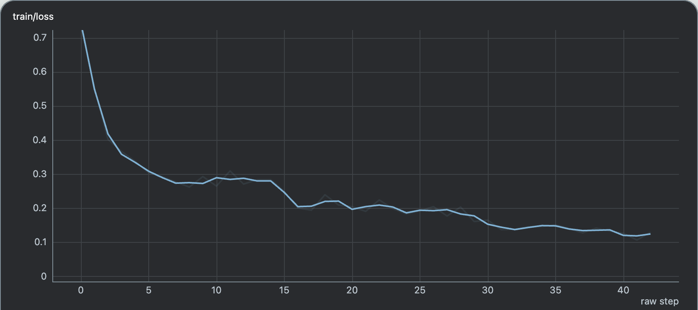 |

The curve shows one recorded training segment, rather than the full trajectory to iter86. The context-capacity experiments on 128×280G Blackwell reported:

| Global batch size | Context | Vision tower | Outcome                             |
| ----------------: | ------: | ------------ | ----------------------------------- |
|               256 |     64k | Trainable    | Stable training in the recorded run |
|               256 |     96k | Trainable    | OOM at step 16                      |
|               256 |     96k | Frozen       | Stable training in the recorded run |
|               512 |    128k | Frozen       | Stable training in the recorded run |

Recipe: [`run-kimi-k3-openr1mm-128xblackwell.sh`](./scripts/run-kimi-k3-openr1mm-128xblackwell.sh).

### Pokémon LoRA

The 64×280G Blackwell LoRA run uses the Chinese Pokémon GPT-4o captions preparation (`pokemon_gpt4o_zh.parquet`). This run demonstrates LoRA optimization on image-caption data; no held-out accuracy was reported.

|                         Training loss                         |                           Gradient norm                            |
| :-----------------------------------------------------------: | :----------------------------------------------------------------: |
| 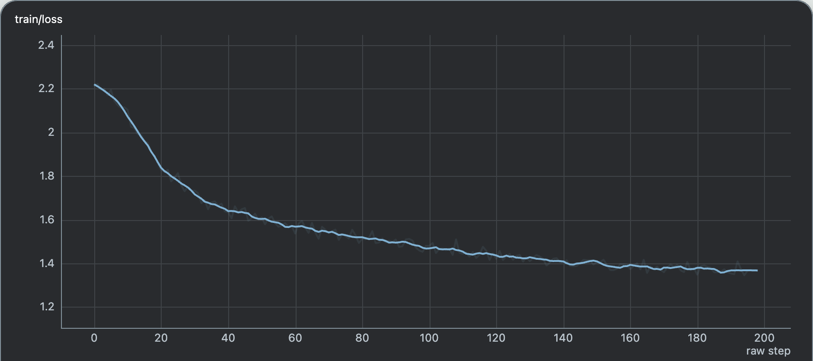 | 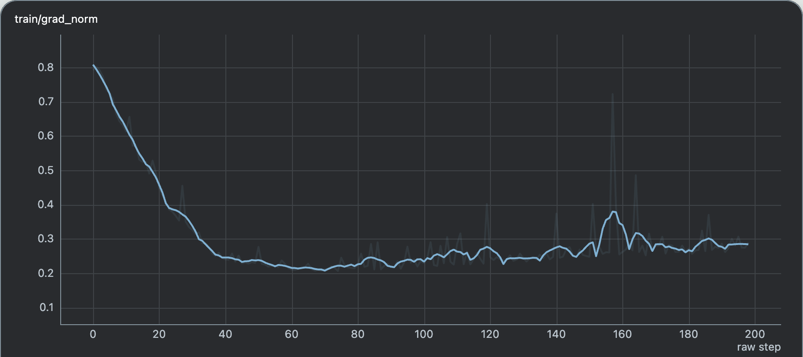 |

Recipe: [`run-kimi-k3-pokemon-lora-64xblackwell.sh`](./scripts/run-kimi-k3-pokemon-lora-64xblackwell.sh).

### LLaVA-OneVision Long-Context SFT

The 128×280G Blackwell run uses frozen vision, global batch size 512 and CP8. Its training log spans steps 0–680, with packed sequences typically around 110k tokens under a 128k context budget. Loss trends downward and most steps take approximately 60 s; initialization and occasional spikes take longer. The run had a large gradient-norm spike later attributed to an FLA KDA issue; FLA 0.5.2 was reported to fix it. No downstream accuracy score was reported for this run.

|                      Training loss                      |                      Step time (s)                       |                              Packed tokens                              |
| :-----------------------------------------------------: | :------------------------------------------------------: | :---------------------------------------------------------------------: |
| 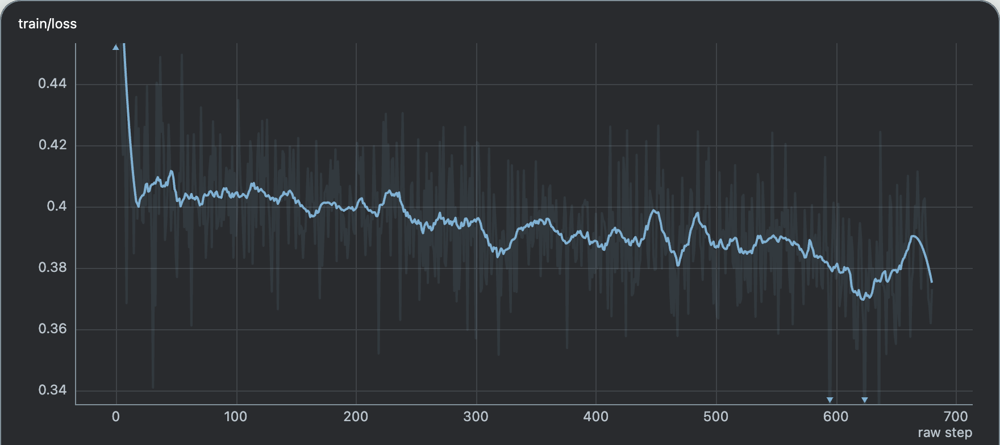 | 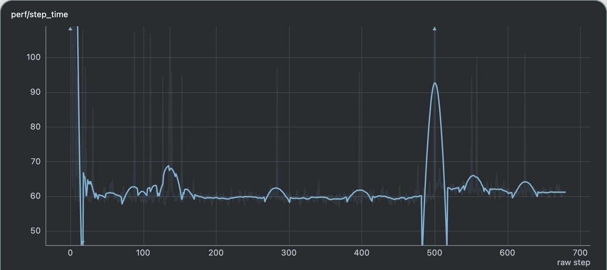 | 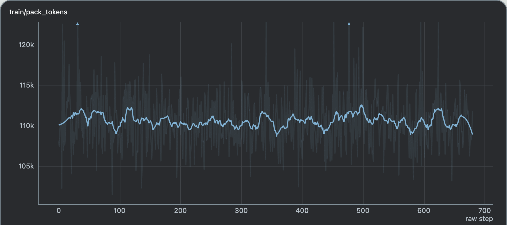 |

Recipe: [`run-kimi-k3-llava-onevision-128xblackwell.sh`](./scripts/run-kimi-k3-llava-onevision-128xblackwell.sh).

### OpenR1-MM GRPO

The full-parameter multimodal GRPO run uses 128×280G Blackwell. In the illustrated run (steps 0–60), rollout reward rises from roughly 0.16 to 0.44, mismatch KL stays around 0.002–0.003, and mean absolute train/rollout logprob difference stays around 0.03. These are training diagnostics, not held-out pass@k results.

|                           Rollout reward                            |                       Train/rollout mismatch KL                       |                              Absolute logprob difference                               |
| :-----------------------------------------------------------------: | :-------------------------------------------------------------------: | :------------------------------------------------------------------------------------: |
| 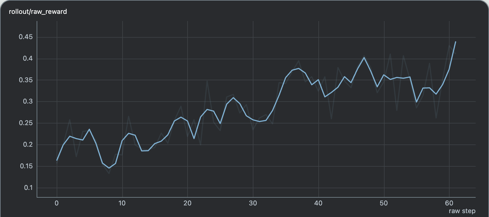 | 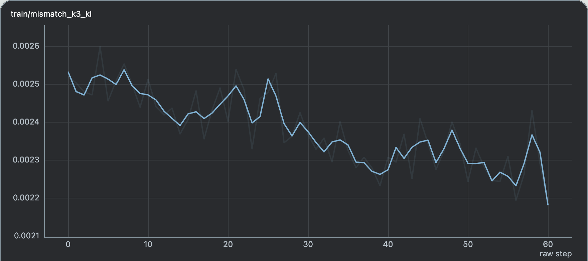 | 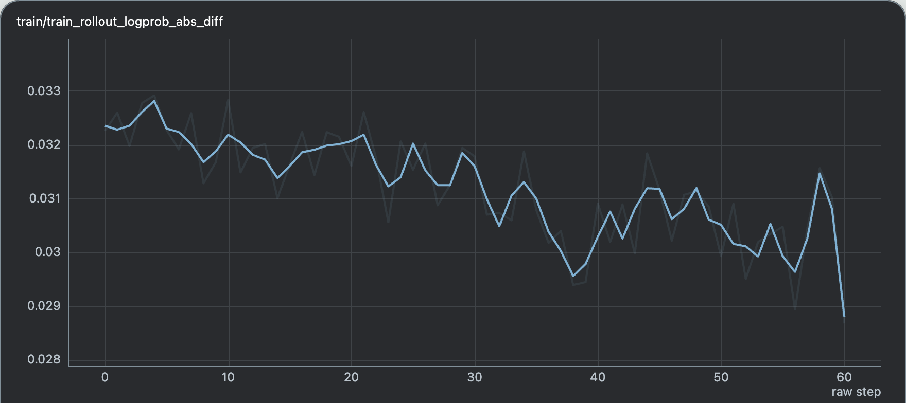 |

The recorded optimization results reduced representative iteration time from about **1100 s to 770 s** (30%) and weight synchronization from about **270 s to 80 s** (70%). These are approximate measurements from separate runs, not controlled throughput benchmarks. The timing comparison below includes a short optimized run recorded through step 8; startup and sequence-length variation affect the curves. Blue is the September 29 optimized run; yellow is the September 28 comparison run.

|                                        Before optimization                                        |                                    Later timing runs                                    |
| :-----------------------------------------------------------------------------------------------: | :-------------------------------------------------------------------------------------: |
| 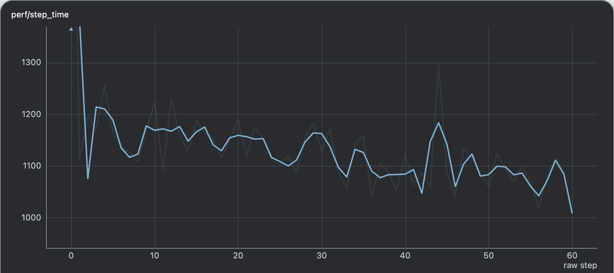 | 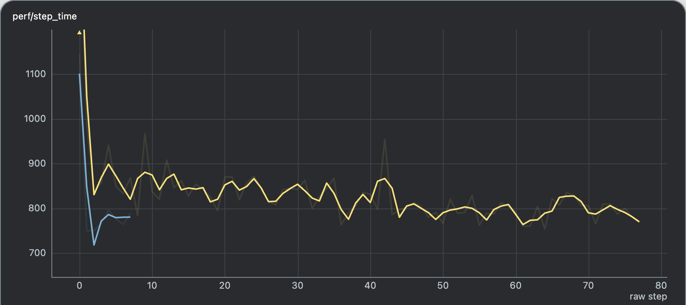 |

Recipe: [`run-kimi-k3-openr1mm-128xblackwell-grpo.sh`](./scripts/run-kimi-k3-openr1mm-128xblackwell-grpo.sh).

## Kimi K3.1 Pro

Use the official `moonshotai/Kimi-K3.1-Pro` checkpoint with `--trust-remote-code` and `--megatron-to-hf-mode bridge`. Relax selects its local K3.1 bridge from `KimiK31ForConditionalGeneration` / `kimi_k31`. The model configuration is `scripts/models/kimi-k3.1-pro.sh`; it reuses K3's backbone dimensions. Existing K3 SFT recipes can also read a K3.1 checkpoint by setting `MODEL_DIR` to that directory and using a new `EXP_NAME` and checkpoint directory.

K3.1 keeps the 93-layer backbone, KDA, latent MoE, AttnRes and image processor. Its 24 MLA layers add a NoPE DSA indexer with 32 heads of dimension 128 and top-2048 key selection. The bridge maps the five new indexer tensors per MLA layer. Indexer weights remain frozen during SFT/RL: hard top-k selection has no language-loss gradient, and this integration does not add an indexer distillation objective. K3.1 uses local trainable MoonViT and projector modules because its HF repository omits the modeling files loaded by K3. FLOPs/MFU are omitted for K3.1 until the estimator accounts for sparse attention and the frozen indexer; throughput and timing are still reported.

The training path uses Core's TileLang sparse attention, padding head tiles when needed for K3's 96 attention heads. If LoRA wraps `kv_b_proj`, the expanded attention path preserves adapter gradients and dropout but uses more memory at long context lengths. The other K3 parallelism limits below still apply.

The pinned Megatron-Bridge already supplies the reusable K3 backbone. Neither Bridge `v0.7.0` nor main at `20874c8db` includes K3.1; upgrading Bridge alone does not enable it. This integration keeps the existing dependency pins. See the [official model config](https://huggingface.co/moonshotai/Kimi-K3.1-Pro/blob/main/config.json) and [Bridge comparison](https://github.com/NVIDIA-NeMo/Megatron-Bridge/compare/6862ee170a2569607e8ebc5dde91f119779093ca...20874c8dbf87af6eafa8c93c0f44586ddc47fe5a).

For RL rollout or serving, the repository's SGLang `v0.5.21` base is insufficient. Use a runtime containing [SGLang #48415](https://github.com/sgl-project/sglang/pull/48415) (`61a3c7f2`, K3.1 support) with Relax's weight-reload patches ported and validated. This change does not upgrade or validate that inference runtime. The K3-specific offline export/streaming LoRA tools below have not been extended to K3.1. GPU numerics, distributed checkpointing and online rollout reload still require validation in the target training image and cluster.

## Training

Run commands from the repository root on an existing Ray cluster. `MODEL_DIR` points directly to the original HF model directory; `DATA_DIR` points to the prepared dataset directory. Existing `HF_CHECKPOINT`, `HELLASWAG_DATA_DIR`, `OPENR1MM_DATA_DIR`, `POKEMON_DATA_DIR` and `LLAVA_DATA_DIR` overrides remain supported.

```bash
export MODEL_DIR=/shared/models/Kimi-K3
export DATA_DIR=/shared/data/openr1mm
export SAVE_DIR=/shared/checkpoints
export EXP_NAME=kimi-k3-openr1mm-full
DRY_RUN=1 bash examples/models/kimi-k3/scripts/run-kimi-k3-openr1mm-128xblackwell.sh
bash scripts/entrypoint/ray-job.sh \
  examples/models/kimi-k3/scripts/run-kimi-k3-openr1mm-128xblackwell.sh
```

| Recipe filename                                  |               GPUs | Input                                              |
| ------------------------------------------------ | -----------------: | -------------------------------------------------- |
| `run-kimi-k3-hellaswag-128xblackwell.sh`         | 128×280G Blackwell | `train.jsonl`, `validation.jsonl`                  |
| `run-kimi-k3-hellaswag-128xblackwell-rawtext.sh` | 128×280G Blackwell | Same files; raw context/target baseline comparison |
| `run-kimi-k3-openr1mm-128xblackwell.sh`          | 128×280G Blackwell | `train.parquet`                                    |
| `run-kimi-k3-llava-onevision-128xblackwell.sh`   | 128×280G Blackwell | `train/` JSONL shards and `READY.json`             |
| `run-kimi-k3-pokemon-64xblackwell.sh`            |  64×280G Blackwell | `pokemon_gpt4o_zh.parquet`                         |
| `run-kimi-k3-pokemon-128xblackwell.sh`           | 128×280G Blackwell | Same Parquet file                                  |
| `run-kimi-k3-pokemon-192xgpu-blackwell.sh`       | 192×280G Blackwell | Same Parquet file                                  |
| `run-kimi-k3-pokemon-lora-64xblackwell.sh`       |  64×280G Blackwell | Same Parquet file; language-backbone LoRA          |

`SAVE_DIR` enables saving to the stable `${SAVE_DIR}/${EXP_NAME}` directory and loading from the same directory. Without it, recipes do not save checkpoints. OpenR1-MM and OneVision save **model weights only** by default; optimizer and scheduler state are not preserved. `SAVE_OPTIMIZER=1` enables full-state saving, which needs substantially more host memory and storage. A model-only checkpoint is not an exact training resume.

The default SFT experiment names now use architecture and memory profiles. To continue an existing experiment after upgrading, keep `SAVE_DIR` unchanged and explicitly set `EXP_NAME` to the original experiment name. Using the new default changes the checkpoint directory and can restart training from the HF weights instead of resuming the existing checkpoint.

OpenR1-MM and OneVision default to frozen vision; set `FREEZE_VISION_TOWER=0` for joint vision training and revalidate memory use. `FLA_TILELANG=0` is passed to training actors by default; an explicit environment override is supported. ClearML uses the existing runtime configuration. Ray submission waits for completion and streams logs by default; set `RAY_NO_WAIT=1` to submit in the background, where submission success does not establish training success.

## OneVision Data Preparation

The processing tool remains at `scripts/tools/prepare_llavaonevision.py`.

```bash
python -m scripts.tools.prepare_llavaonevision prepare \
  --output-dir /shared/data/onevision --workers 8
export DATA_DIR=/shared/data/onevision/sft
```

Preparation pins the dataset revision in a manifest, extracts embedded images into shared files and publishes `READY.json` only after all shards complete. Re-running resumes completed shards. `--subsets` produces `SUBSET_READY.json` for smoke preparation; it is not a complete dataset readiness marker.

The `sample` subcommand can instead select a fixed number of valid rows from locally cached Parquet shards. Its images are inline data URIs. For a complete dataset, use `prepare` and make the extracted image paths accessible from every training node.

## Export

Run conversion inside the compatible training image, connected to a Ray cluster. `CKPT_PATH` must point to one `iter_*` directory. The original HF directory supplies model configuration, tokenizer and native quantization layout.

```bash
export CKPT_PATH=/shared/checkpoints/experiment/iter_0000100
python examples/models/kimi-k3/tools/convert_kimi_k3_torch_dist_to_hf_parallel.py \
  --input-dir "${CKPT_PATH}" --origin-hf-dir "${MODEL_DIR}" \
  --output-dir "${CKPT_PATH}_hf" \
  --world-size 16 --tp 4 --pp 1 --ep 16 --expert-tp 1 \
  --cpus-per-worker 16
```

The parallel exporter requires PP=1, expert-TP=1 and EP=world-size. It validates the output before publishing. Existing output is rejected unless `--replace-output` is explicitly supplied.

For a language LoRA checkpoint, use the **exact original model used for training**:

```bash
python examples/models/kimi-k3/tools/merge_kimi_k3_lora_to_hf.py \
  --input-dir "${CKPT_PATH}" --origin-hf-dir "${MODEL_DIR}" \
  --output-dir "${CKPT_PATH}_hf" --workers 8 --cpus-per-worker 4
```

This produces full HF weights with LoRA merged before native MXFP4 quantization. Vision adapters are not supported by this merge path. `compare_kimi_k3_hf_exports.py` and `validate_kimi_k3_parallel_export.py` in the same tools directory provide shard comparison and quantization checks.

## Validation and Serving

The temporary SGLang validator requires a log directory:

```bash
python examples/models/kimi-k3/tools/validate_kimi_k3_sglang.py \
  --model-path "${CKPT_PATH}_hf" --log-dir "${CKPT_PATH}_serve_logs" \
  --tp-size 8 -- \
  --weight-loader-prefetch-checkpoints --context-length 16384 \
  --max-running-requests 16 --cuda-graph-max-bs 16 --disable-decode-cuda-graph
```

Its built-in checks are text-only. Use `scripts/tools/eval_openr1mm.py` for image evaluation; inspect `--help` for endpoint, dataset and output arguments.

## Reinforcement Learning

Kimi K3 supports colocated GRPO with native MXFP4 rollout weights. Training keeps BF16 expert parameters; after each update, Bridge converts routed experts into paired `weight_packed` / E8M0 `weight_scale` tensors. Dense, shared-expert and vision weights retain their configured unquantized format. Quantization configuration is read from either the top level or `text_config`.

The SGLang v0.5.17 patch shipped in this repository must be installed on **every rollout node**. Its reload hooks preserve captured runtime storage while refreshing MXFP4 repacks, fused decode buffers, MLA projections and AttnRes caches. The router supports worker removal and re-registration without applying stale requests or health checks to a replacement worker. PP weight conversion broadcasts cleaned configuration copies and avoids repeating TP/EP collectives after weights have already been gathered.

| Recipe                                                                       | Layout                                             | Purpose                                                              |
| ---------------------------------------------------------------------------- | -------------------------------------------------- | -------------------------------------------------------------------- |
| `scripts/training/text/run-kimi-k3-5l-8xgpu-grpo.sh`                         | Training TP2/EP4/ETP1, rollout TP8; 8 GPUs         | Reduced 5-layer/128-expert checkpoint, text-only DAPO math smoke run |
| `examples/models/kimi-k3/scripts/run-kimi-k3-openr1mm-128xblackwell-grpo.sh` | Training TP4/PP4/CP2/EP32/ETP1; 128×280G Blackwell | Full-parameter multimodal OpenR1-MM GRPO, including vision           |

The full recipe uses PP layer counts 21/24/24/24, eight 16-GPU rollout engines with attention TP8/DP2 and MoE EP16, CPU optimizer offload (default fraction 0.9), dummy rollout initialization followed by a full weight push, and no reference model. It clears inherited allocator settings, limits compiler threads and keeps Ray Serve probes responsive during weight synchronization. Defaults are 200 training rollouts and a model-only save every 200 rollouts, retaining one checkpoint. It initializes from HF unless `LOAD_DIR` is set. Model-only checkpoints do **not** restore optimizer state.

```bash
export MODEL_DIR=/shared/models/Kimi-K3
export DATA_DIR=/shared/data/openr1mm
export SAVE_DIR=/shared/checkpoints
export EXP_NAME=kimi-k3-openr1mm-grpo
export HF_CHECKPOINT="${MODEL_DIR}"
export PROMPT_SET="${DATA_DIR}/train.parquet"
DRY_RUN=1 bash examples/models/kimi-k3/scripts/run-kimi-k3-openr1mm-128xblackwell-grpo.sh
bash scripts/entrypoint/ray-job.sh \
  examples/models/kimi-k3/scripts/run-kimi-k3-openr1mm-128xblackwell-grpo.sh
```

The full recipe defaults to `${MODEL_DIR}/Kimi-K3` for model weights and `${DATA_DIR}/multimodal-open-r1-8k-verified/data/train-00000-of-00001_converted_noextract.parquet` for data with `prompt`, `label` and `image` fields. The example above sets `HF_CHECKPOINT` and `PROMPT_SET` explicitly to reuse the SFT directory layout. The reduced recipe expects `dapo-math-17k.jsonl` under `DATA_DIR` and the reduced checkpoint directly under `MODEL_DIR`. Its entropy coefficient 0.01 keeps gradients nonzero when the unretrained smoke checkpoint receives zero rewards; it is not a quality baseline. Optional `SAVE_DIR` enables full-state saves and resume for this reduced recipe. Experiment names and checkpoint paths are stable; timestamps appear only in log/task names. ClearML uses existing runtime configuration.

The full recipe enables expert-routed weight updates by default; set `COLOCATE_EXPERT_WEIGHT_ROUTING=0` to use broadcast. Dynamic sampling filters are disabled by default; they can be enabled with explicit CLI arguments.

The full OpenR1-MM recipe selects the Kimi K3 reward in [`rewards/openr1mm.py`](./rewards/openr1mm.py) through `--custom-rm-path examples.models.kimi-k3.rewards.openr1mm.reward_func`. It scores complete final answers, including XML `<answer>...</answer>` blocks and Kimi-native final channels; unfinished or ambiguous final answers receive zero reward. Use this custom path when adapting the recipe. The reduced DAPO math recipe uses `deepscaler`.

Both recipes enable `OPEN_TRAINING_MXFP4_FAKE_QAT_FLAG=1` and `FLA_TILELANG=0` through `--train-env-vars`. Fake QAT uses a straight-through estimator: routed-expert forward weights use the same quantize/dequantize grid as online MXFP4 export, while gradients reach the BF16 master. The hook is disabled by default outside these recipes. Rollout sends exactly one raw media token per image; the training processor retains the original prompt and performs its own image expansion.

### Bounded Synchronous Checkpoint Saving

Both Dockerfiles apply `docker/patch/megatron/sync-save-bounded-staging.patch` after the main Megatron patch. The full GRPO recipe explicitly enables it; set `MEGATRON_SYNC_SAVE_BOUNDED_STAGING=0` to revert that recipe to the original synchronous writer. For other launches, the patch defaults to disabled. Async saving is unchanged.

- `MEGATRON_SYNC_SAVE_BOUNDED_STAGING=1`: stage a bounded window and write sequentially instead of preloading the complete checkpoint onto CPU.
- `MEGATRON_SYNC_SAVE_STAGE_BYTES`: per-rank live staging budget, default 1 GiB. A single larger tensor is allowed when the window is empty, so the bound is `max(budget, largest_tensor)`.
- Budget `0` stages/writes one tensor at a time; it does **not** select the original writer.
- This bounds live staging tensors, not total RSS, optimizer/offload memory, serialization scratch or filesystem page cache. Writing may trade throughput for memory; measure on the target storage.

The recipe forwards both environment variables to training actors. Old images without this patch continue using their original save implementation even if these variables are set; rebuild or patch all nodes consistently to obtain the optimization. Existing running jobs do not pick up the patch. Checkpoint format and loading remain unchanged. See `docker/patch/megatron/sync-save-bounded-staging.md` for failure handling and validation limits.

### Diagnosing Train/Rollout Differences

`examples/models/kimi-k3/tools/probe_mxfp4_mismatch_floor.py` compares prompt logprobs for native MXFP4 and BF16-dequantized copies, using identical token IDs and the same SGLang engine. Supply `--mxfp4-dir`, `--bf16-dir`, `--data` and optionally `--n-prompts`. It uses TP1, so each tested checkpoint must fit on one GPU. This is a diagnostic reference, not a proof that an online weight push is correct: also check reload storage identity, finite losses/gradients and repeated updates in the target image. CPU tests do not establish CUDA-graph, quantization-kernel or multi-node save/reload correctness.

## Limits

- MTP, dynamic CP, all-gather CP and VPP are not supported for Kimi K3. Fixed CP uses zigzag partitioning; TP greater than one requires sequence parallelism.
- Large context lengths, joint vision training and full-state checkpoint saves require separate capacity validation. These scripts do not establish 256k-context readiness.
- CPU unit tests and Gloo tests do not validate NCCL, multi-node Ray export, CUDA quantization or actual image serving. Run those checks in the target image and cluster before merging for production use.

## Next Steps

- [SFT Training](../../../docs/en/guide/sft-training.md)
- [Model Checkpoint Conversion](../../../docs/en/guide/model-conversion.md)
- [LoRA Training](../../../docs/en/guide/low-rank-adaptation-training.md)
