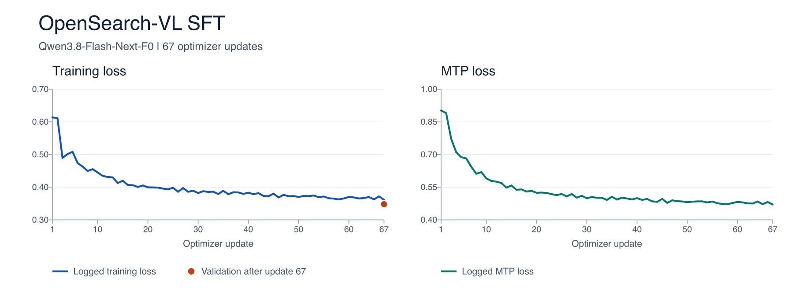

# Qwen3.8-Flash-Next 训练

[English](./README.md)

## 模型介绍

Qwen3.8-Flash-Next 是带视觉编码器的多模态 MoE 模型，语言主干有 48 层、125B 参数，每个 token 激活 6B，另有 51B n-gram embedding 表和 4B 多 token 预测（MTP）模块。主干每三层 Gated DeltaNet（GDN）接一层 Qwen Sparse Attention（QSA）。QSA 最多选择 512 个四 token 块。Gated Residual 在四条残差流之间混合，Per-Layer Embedding（PLE）引入 bigram 和 trigram 特征。发布权重的原生上下文为 262,144 token。 [模型卡](https://huggingface.co/Qwen/Qwen3.8-Flash-Next) · [架构报告](https://arxiv.org/abs/2608.30320)

Relax 提供 Megatron/Bridge 全模型和 LoRA 监督微调（SFT）和 Megatron/SGLang 共置 GRPO 配方。模型的公共配置在 [`qwen38-flash-next.sh`](../../../scripts/models/qwen38-flash-next.sh)。下文的全模型 SFT 配方使用 BF16，冻结 QSA 索引器、视觉编码器和投影层，并训练一层 MTP。H800 冻结 n-gram 表，H20 和 Blackwell SFT 配方冻结整个 PLE 模块。

## 快速开始

所有 worker 使用同一 Relax 版本和匹配的镜像。[`docker/Dockerfile.cu13`](../../../docker/Dockerfile.cu13) 的 `relax` 构建目标支持 `GPU_ARCH=hopper` 和 `GPU_ARCH=blackwell`，包含固定版本的 Megatron/Bridge 补丁。以下命令在已启动的独占 Ray 集群 head 节点上，从仓库根目录运行。HF 权重、输入数据、图片和输出目录均使用所有 worker 可访问的共享路径。

`MODEL_DIR` 指向包含 MTP 权重的完整 HF checkpoint。SFT 使用 JSONL，每行提供完整的 `messages`，工具调用可附 `tools`。图文样本中，每张图片在用户消息里有一个 `<image>` 占位符，并在 `images` 中有对应路径。 [SFT 数据格式](../../../docs/zh/guide/sft-training.md)

```json
{"messages":[{"role":"user","content":"<image>What shape is shown?"},{"role":"assistant","content":"A triangle."}],"images":["/shared/data/triangle.png"]}
```

**Hopper（128×H800）。** 设置 `PROFILE_STEP=0` 可关闭调用栈采集。脚本默认从 HF 权重开始执行 15 次更新。设置 `SAVE_INTERVAL` 开启训练 checkpoint 保存与恢复，续跑时沿用 `SAVE_DIR/EXP_NAME`。

```bash
export MODEL_DIR=/shared/models/Qwen3.8-Flash-Next
export DATA_DIR=/shared/data/train.jsonl
export SAVE_DIR=/shared/checkpoints
export RELAX_SKIP_CLUSTER_CLEANUP=1

DRY_RUN=1 PROFILE_STEP=0 USE_CLEARML=0 \
  bash examples/models/qwen3.8-flash-next/scripts/run-qwen38-qsa-sft-128xh800.sh
# After checking the arguments, submit from the Ray head.
PROFILE_STEP=0 USE_CLEARML=0 \
  bash examples/models/qwen3.8-flash-next/scripts/run-qwen38-qsa-sft-128xh800.sh
```

**32×280G Blackwell。** 在 Blackwell 镜像中，让 `MEGATRON` 指向镜像中打过补丁的源码。镜像会提供 `RELAX_HYBRID_EP_COMMIT`。设置 Ray Jobs HTTP 地址，续跑时沿用 `EXP_NAME` 和 `SAVE_DIR/EXP_NAME`。

```bash
export MODEL_DIR=/shared/models/Qwen3.8-Flash-Next
export DATA_DIR=/shared/data/train.jsonl
export SAVE_DIR=/shared/checkpoints
export MEGATRON=/root/Megatron-LM
export RAY_JOBS_ADDRESS=http://ray-head:8265
export EXP_NAME=qwen38-sft-blackwell

DRY_RUN=1 bash examples/models/qwen3.8-flash-next/scripts/run-qwen38-qsa-sft-32xgpu-blackwell.sh
bash examples/models/qwen3.8-flash-next/scripts/run-qwen38-qsa-sft-32xgpu-blackwell.sh
```

| 配方                                                                                                                                                                                            | GPU               | SFT 默认配置                                                                                   |
| ----------------------------------------------------------------------------------------------------------------------------------------------------------------------------------------------- | ----------------- | ---------------------------------------------------------------------------------------------- |
| [H800 图文](./scripts/run-qwen38-qsa-sft-128xh800.sh)                                                                                                                                           | 128×H800          | TP4/PP8/CP1/EP8/ETP1，GBS512，单样本上限 32K、packing 预算 64K                                 |
| [H20 图文](./scripts/run-qwen38-qsa-sft-40xh20.sh)                                                                                                                                              | 40×H20            | TP4/PP5/CP1/EP4/ETP1，GBS1024，单样本及 packing 上限 64K，从 HF 权重开始更新 100 次            |
| [Blackwell 图文](./scripts/run-qwen38-qsa-sft-32xgpu-blackwell.sh)                                                                                                                              | 32×280G Blackwell | TP2/PP4/CP1/EP8/ETP1，GBS512，单样本及 packing 上限 128K，HybridEP，mixed QSA 长文档走 Grouped |
| [NV 纯文](./scripts/run-qwen38-qsa-nv-text-sft-32xgpu-blackwell.sh) / [NV 图文](./scripts/run-qwen38-qsa-nv-sft-32xgpu-blackwell.sh)                                                            | 32×280G Blackwell | 并行度与 128K 预算同上，长文档走 cuDNN QSA，纯文配方单独划分 PP 层数                           |
| [Blackwell 长上下文](./scripts/run-qwen38-qsa-sft-256k-32xgpu-blackwell.sh)                                                                                                                     | 32×280G Blackwell | packing 软预算 128K，单样本可放宽到 256K，GBS4096，默认 HybridEP。超长单样本仍可能 OOM。       |
| [Blackwell OpenR1-MM SFT](./scripts/run-qwen38-qsa-sft-openr1mm-32xgpu-blackwell.sh)                                                                                                            | 32×280G Blackwell | 单样本及 packing 上限 32K，GBS128，默认 MoK。设置 `MOE_BACKEND=hybridep` 可切换到对照后端。    |
| [Blackwell LoRA SFT](https://github.com/redai-studio/Relax/blob/c75b0a1cb3d03119b02933036287b8c6ad605cf0/examples/models/qwen3.8-flash-next/scripts/run-qwen38-qsa-lora-sft-8xgpu-blackwell.sh) | 8×Blackwell       | TP2/PP1/CP1/EP8，单样本及 packing 上限 128K，GBS512，默认 rank 32 的语言 LoRA，使用 merge 模式 |

为 OpenR1-MM 准备 SFT 数据时，将公开数据的 `problem` 和 `solution` 分别映射为用户和助手消息，并将图片保存在 `images` 对应的共享路径。[OpenR1-MM 数据集](https://huggingface.co/datasets/lmms-lab/multimodal-open-r1-8k-verified)

OpenR1-MM GRPO 读取转换后的 Parquet，字段为 `prompt`、`label` 和 `image`。DAPO Math GRPO 用 DAPO Math 17K JSONL 训练，用 AIME 2024 JSONL 评估。 [GRPO 数据工具](../../../scripts/tools/process_openr1.py) · [H800 OpenR1-MM](./scripts/run-qwen38-flash-next-openr1mm-128xgpu.sh) · [Blackwell OpenR1-MM](./scripts/run-qwen38-flash-next-openr1mm-grpo-blackwell.sh) · [Blackwell DAPO Math](./scripts/run-qwen38-flash-next-dapo-math-grpo-blackwell.sh)

## 验证指标

下表记录已公开的性能对照、对应配置和统计步数。TPS/GPU 用逻辑 token 总数除以累计耗时和 GPU 数。端到端 TPS 用整步耗时，Actor TPS 用训练阶段耗时。H20 对比中的参考 MFU 使用固定的有效工作量估算，单卡参考峰值为 148 TFLOP/s。

| 硬件与负载                                     | 公开结果                                                                                                                                                                                                                                       | 来源                                                                                     |
| ---------------------------------------------- | ---------------------------------------------------------------------------------------------------------------------------------------------------------------------------------------------------------------------------------------------- | ---------------------------------------------------------------------------------------- |
| 32×H20，CUDA 12 全模型图文 SFT 短跑            | 完成 2 次含图片的优化器更新。                                                                                                                                                                                                                  | [镜像与训练短跑](https://github.com/redai-studio/Relax/pull/517#issuecomment-6745583406) |
| 32×H20，128K packing，全模型图文 SFT           | 第 5–9 步，单开 selective logits 为 1,026.0 端到端 TPS/GPU、32.42% 参考 MFU。同窗叠加 fused linear CE 为 1,014.4 TPS/GPU、32.06% 参考 MFU。两次运行的代码版本和宿主机有差异。                                                                  | [Hopper CE 验证](https://github.com/redai-studio/Relax/pull/643)                         |
| 32×Blackwell，图文 SFT                         | PP 切分相同，第 20–49 步从 Grouped 切到 cuDNN QSA，端到端 TPS/GPU 从 3,235.2 到 3,560.4（+10.05%）。                                                                                                                                           | [NV QSA 实测](https://github.com/redai-studio/Relax/pull/509)                            |
| 32×Blackwell，纯文 SFT                         | cuDNN QSA 加 PP 重切使第 20–45 步 Actor TPS/GPU 从 3,224.8 到 3,487.7（+8.15%）。该窗口包含基线采集 profile 的步。                                                                                                                             | [NV QSA 实测](https://github.com/redai-studio/Relax/pull/509)                            |
| 32×Blackwell，128K packing，历史 CuTe/MoK 环境 | CP1 从 Grouped 到 CuTe，第 3–5 步 Actor 吞吐提高 17.23%。另有一次 CP1 运行累计完成 200 次更新，包含从 checkpoint 49 续训。                                                                                                                     | [CuTe 与 CP 实测](https://github.com/redai-studio/Relax/pull/691)                        |
| 32×Blackwell，128K packing，历史静态 CP2/CP4   | 对比各自 CP 基线，预建 GDN route 使 Actor 吞吐分别提高 15.27%/18.82%。在此基础上同时打开 PLE 卷积融合和 TP selector，再提高 5.79%/11.37%。最终配置相对 CuTe CP1 的峰值 allocated 显存分别下降 16.07%/26.00%，Actor 吞吐分别下降 8.10%/26.16%。 | [CuTe 与 CP 实测](https://github.com/redai-studio/Relax/pull/691)                        |

### Blackwell 上的 OpenSearch-VL SFT

本次 OpenSearch-VL 训练使用 32 张 280G Blackwell GPU 对 Qwen3.8-Flash-Next-F0 做 SFT，启用 cuDNN QSA，并冻结视觉编码器和 PLE。评测对比原始 F0 权重和 step 66 的最终 BF16 SFT 权重（共 67 次优化器更新）。两个模型均在 Blackwell 上使用 TP2，按同一套 JSON `crop` 协议评测，上下文为 32K，每题最多 10 轮。 [V\*Bench 评测协议](../../opensearch_vl/evaluation.md)

| 权重              | 正确题数 / 总题数 | Pass@1 | 训练集去重 Pass@1 |
| ----------------- | ----------------- | ------ | ----------------- |
| F0 基座           | 39 / 191          | 20.42% | 20.42%            |
| OpenSearch-VL SFT | 161 / 191         | 84.29% | 84.29%            |

按训练集去重后仍保留全部 191 题。基座有 146 道题因工具调用格式错误而中断，SFT 在其中答对了 122 道。 在剩余题目中，两版得分均为 39/45。这组分数反映同一 crop 协议下的任务完成率。 [OpenSearch-VL 数据准备](../../opensearch_vl/data-preparation.md)



67 次更新中，训练 loss 从 0.6138 降到 0.3614。最后一次更新后的留出轨迹验证 loss 为 0.3479，PPL 为 1.4160。

### H800 图文 SFT 的 64K 与 128K 实测

这些 128 卡对照在每组内使用相同的 HF 权重，逐步 token 数对齐。64K 使用 TP4/PP8/CP1/EP8/ETP1、GBS512。128K 使用 TP8/PP8/CP1/EP8/ETP1、GBS1024。表中的 TPS/GPU 为日志记录的逐步端到端速率均值。

| Packing 与配置变化                                                | 统计步数 |         整步耗时 |      端到端 TPS/GPU |
| ----------------------------------------------------------------- | -------: | ---------------: | ------------------: |
| 64K，调整 PP 层分布，Adam 状态留在 GPU                            |     2–10 | 40.33 → 38.85 秒 | 1,032.88 → 1,071.36 |
| 128K，从 Triton v2 切到实验版 Triton QSA，预取 K/V 并调整反向实现 |     4–27 | 97.08 → 93.11 秒 |     909.41 → 946.04 |
| 128K，在实验版 QSA + NVLS 上加入 Triton GDN 输入投影前向          |      4–8 | 93.05 → 91.72 秒 |     940.83 → 956.84 |

64K 调优配置的整卡显存采样峰值为 65.93 GiB。128K 的 GDN 前向方案完成了 9 次配对更新，训练 loss 和 MTP loss 的最大相对差分别为 0.111% 和 0.056%。后续叠加 split-K 投影权重梯度算子，第 4–8 步测得 898.55 TPS/GPU，统计窗口保留了一个长尾步。上述 128K 算子属于实验实现。 [H800 参考配方](./scripts/run-qwen38-qsa-sft-128xh800.sh)

### H800 可训练 PLE

128 张 H800 上的 32K 实验对比了 CPU 冻结 n-gram 表（`QWEN38_PLE_CPU_OFFLOAD=1`）和 GPU 可训练表（`QWEN38_PLE_CPU_OFFLOAD=0`）。两组使用相同的初始权重、数据 batch 和并行拓扑，完成 50 次更新。GPU 组将 n-gram 表移出冻结规则，设置 `RELAX_QWEN38_PLE_STREAMED=0`，并在启动配方中做了显存调优。Loss 取第 6–50 次更新均值，吞吐对两组都排除了写 checkpoint 的第 26 次。

| PLE n-gram 表 | 平均 TPS/GPU | 平均训练 loss | 平均 MTP loss |
| ------------- | -----------: | ------------: | ------------: |
| CPU 冻结表    |       528.72 |       0.90678 |       1.20293 |
| GPU 可训练表  |       433.87 |       0.90643 |       1.19943 |

在第 50 次更新的 checkpoint 中，可训练表对应的 Adam 动量已经出现非零值。另一组 64×H800 训练用 32K packing、TP8/PP8/CP1/EP8，在第 500 次更新后保存了可训练表的全部 8 个分片。完整尺寸的优化器状态重新加载和续训一步对齐仍待验证。公开 H800 脚本默认使用 CPU 冻结表。

### 待补的公开复现

- 在公开数据上复现 H800 吞吐对照，并实测当前 40×H20 脚本的端到端性能。记录数据版本与切分、镜像 digest、生效配置、训练 loss、MTP loss、梯度范数、留出集 loss、TPS/GPU 和整卡显存峰值。现有 PR 提供脚本配置验证。 [H800 配方](https://github.com/redai-studio/Relax/pull/637) · [H20 默认值](https://github.com/redai-studio/Relax/pull/635)
- 发布准备好的 OpenR1-MM SFT 数据，或提供可复现的转换及切分方式。补原始权重和 SFT checkpoint 在同一留出集上的分数，附评分规则和解码参数。GRPO 补 reward、训练与 rollout 的 log-probability 差异以及留出集分数。 [OpenR1-MM 评测脚本](../../../scripts/tools/eval_openr1mm.py)
- 在 280G Blackwell 上用发布镜像复验 CuTe 与 MoK，补齐 MoK 对 HybridEP 的对照、256K 单样本的显存和运行结果，以及 checkpoint 保存和恢复验证。对照时固定数据、packing、重算和统计窗口。 [CuTe 验证范围](https://github.com/redai-studio/Relax/pull/691) · [MoK 验证范围](https://github.com/redai-studio/Relax/pull/704)

## Hopper 优化

| 方向                      | 配方设置                                                                                                                                                                                                                                                                                                                                                                                                                          |
| ------------------------- | --------------------------------------------------------------------------------------------------------------------------------------------------------------------------------------------------------------------------------------------------------------------------------------------------------------------------------------------------------------------------------------------------------------------------------- |
| QSA attention 与 selector | 两套配方都用 `MCORE_QSA_SPARSE_BACKEND=flex`，配合 `RELAX_QWEN38_QSA_FUSED_ATTENTION=triton_v2` 和 `RELAX_QWEN38_QSA_FUSED_SELECTOR=1`。符合条件时融合算子直接处理选中的块。H800 设置 `RELAX_QWEN38_QSA_SELECTOR_TILE_MIB=384`，限制 selector 的分块大小。                                                                                                                                                                        |
| Logits 与交叉熵           | 两套配方都启用 `--sft-chunked-logits`、`RELAX_SFT_SELECTIVE_LOGITS=1` 和 `RELAX_SFT_SELECTIVE_MULTIMODAL_LOGITS=1`。符合条件的 CP1 packed SFT 和 MTP batch 根据实际 loss mask 选行。两套配方均默认 `RELAX_SFT_FUSED_LINEAR_CE=0`，Hopper 可在满足运行条件时选用 Quack 融合路径。 [Selective logits](https://github.com/redai-studio/Relax/pull/637) · [Hopper CE](https://github.com/redai-studio/Relax/pull/643)                 |
| MoE 与并行                | 两套配方均使用 `--sequence-parallel`、`--moe-token-dispatcher-type flex`、`--moe-flex-dispatcher-backend deepep` 和 `--moe-grouped-gemm`。H800 额外设置 `--moe-flex-dispatcher-num-sms 24` 和 `--moe-shared-expert-overlap`。                                                                                                                                                                                                     |
| 激活、PLE 与优化器        | 两套配方都启用 `RELAX_QWEN38_FLA_CONV_CACHE_REUSE=1`，并通过 `QWEN38_PLE_CPU_OFFLOAD=1` 将冻结的 n-gram 表放在 CPU。H800 还启用 HC mix/combine 与 PLE 卷积融合、`--chunked-optimizer-state-offload`、`--overlap-grad-reduce` 和 `--overlap-param-gather`。`RELAX_QWEN38_RETAIN_QSA_ATTENTION=1` 配合 `last_stage_l48` 策略，在最后一段 PP 保留第 48 层 attention 以及第 47 层和 MTP 的完整激活。将该开关设为 `0` 可还原常规重算。 |

`RELAX_QWEN38_PLE_STREAMED=1` 是另一个显存开关，要求冻结所有 PLE 参数，并使用 packed THD 和 CP>1。 [Streamed PLE 验证](https://github.com/redai-studio/Relax/pull/666)

公开的 [H20 QSA 合成数据回放](https://github.com/xiaoliang0601/Relax/blob/0f6fe4baea288d1aa5419e2e3814e7ff8ad24c38/examples/models/qwen3.8-flash-next/qsa_benchmark/RESULTS.md) 记录了多组 head 配置和文档长度组合下的算子耗时。比较 packed 输入上的稀疏算子时，同时看单篇文档长度和每个 TP rank 的 Q/KV head 数。

## Blackwell 优化

| 方向               | 设置与前提                                                                                                                                                                                                                                                                                                                                                                                                                 |
| ------------------ | -------------------------------------------------------------------------------------------------------------------------------------------------------------------------------------------------------------------------------------------------------------------------------------------------------------------------------------------------------------------------------------------------------------------------- |
| Mixed QSA          | 32 卡 SFT 配方选择 `RELAX_QWEN38_QSA_COMMUNITY_BACKEND=mixed`。短文档走 Flash，长文档默认 `RELAX_QWEN38_QSA_MIXED_LONG_BACKEND=grouped`。`cudnn_pr1765` 是 CP1 下的另一个选项，要求本地 12Q/1KV/D256 和固定版本的 cuDNN Frontend。NV 配方中，单篇文档长度不超过 2,051 token 时走 Flash。 [NV 镜像与路由](../../../docs/zh/guide/qwen38-qsa.md)                                                                             |
| CuTe QSA 与静态 CP | 在 32 卡配方中设置 `RELAX_QWEN38_QSA_MIXED_LONG_BACKEND=cute`。CP2 或 CP4 同时设置 `QWEN38_CP_SIZE=2` 或 `4`，以及 `RELAX_QWEN38_QSA_CP=1`。可选开关包括 `RELAX_QWEN38_GDN_CP_PREBUILD_ROUTE=1`、`RELAX_QWEN38_PLE_CP_FUSED_CONV=1`，以及配合 `torch` selector 的 `RELAX_QWEN38_QSA_CP_TP_SELECTOR=1`。这条路径使用 BF16、静态 packed CP 和冻结的 Stage-1 索引器。 [CuTe 启动与约束](../../../docs/zh/guide/qwen38-qsa.md) |
| Megatron MoE       | 128K 配方使用 `--moe-flex-dispatcher-backend hybridep`、`--moe-hybridep-pad-variable-tokens`、`--moe-shared-expert-overlap`、`--overlap-grad-reduce` 和 `--overlap-param-gather`。长上下文和 OpenR1-MM SFT 配方可选 MoK，对应 `--moe-megakernel-backend mok`。该配置要求 SM103 派生镜像和节点内 EP8。 [MoK 镜像与启动参数](../../../docker/mok/README.md)                                                                  |
| 模型融合算子       | 128K 和 256K 配方均启用 `RELAX_QWEN38_HC_FUSED_MIX=1`、`RELAX_QWEN38_HC_FUSED_COMBINE=1` 和 `RELAX_QWEN38_PLE_FUSED_CONV=1`。128K 配方的 `NVTE_USE_CUTLASS_GROUPED_GEMM` 单独控制 MoE GEMM，默认 `0`。                                                                                                                                                                                                                     |
| 长上下文显存       | 256K 配方启用优化器状态分块卸载、CPU PLE 和 `RELAX_QWEN38_HC_RECOMPUTE=1`。`SEQ_LENGTH` 设置单样本上限，`MAX_TOKENS_PER_GPU` 设置 packing 软预算。                                                                                                                                                                                                                                                                         |

更长上下文可在 32 张 Blackwell 上使用 TP1/PP2/EP8/ETP1 搭配 CP8 或 CP16 的 HybridEP 路径，同时启用 mixed CuTe QSA CP。完全冻结 PLE 参数并使用静态 packed THD 时，设置 `QWEN38_PLE_INPUT_HALO_CP=1` 和 `QWEN38_PLE_INPUT_HALO_TRANSPORT=adaptive`，让每卡计算自己的 PLE 输出，在文档分片足够长时只交换卷积需要的左侧边界。历史对照保持局部计算开启，仅将通信从 `full` 切到 `adaptive`。各跑 3 步，512K/CP8 的 PyTorch 峰值 allocated 显存从 204.05 降到 200.02 GiB，1M/CP16 从 171.72 降到 157.67 GiB。两组对照中，3 步的训练 loss、MTP loss 和梯度范数均逐值一致。 [长上下文设置](https://github.com/redai-studio/Relax/blob/c75b0a1cb3d03119b02933036287b8c6ad605cf0/docs/zh/guide/qwen38-qsa.md) · [显存结果](https://github.com/redai-studio/Relax/pull/716)

对照组使用各自的 checkpoint 目录。报告单算子收益时，用 trace 核对实际执行的 attention 和 MoE 路径。 [性能调优](../../../docs/zh/guide/performance-tuning.md)
