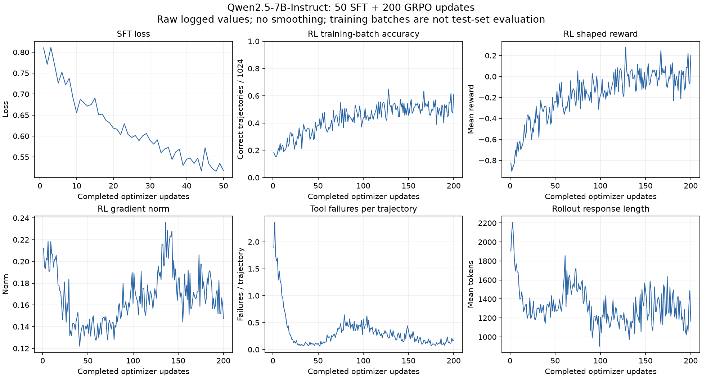

# ReTool

[ReTool](https://arxiv.org/abs/2504.11536) trains a language model to interleave mathematical reasoning with Python execution. This example implements the workflow in Relax: prepare the author's SFT data, train with native Megatron, run multi-turn SGLang rollouts with GRPO, and evaluate the official and trained checkpoints on four math benchmarks.

## Requirements

- A single Linux node with eight GPUs; the recorded run used eight 80 GB GPUs, TP2 and BF16.
- The [Relax runtime image](../../README.md#installation) and its matching Megatron-LM checkout. Install the repository with `pip install -e .` inside that environment; the preparation commands also use `datasets`, `huggingface_hub`, `pyarrow` and `transformers`.
- Root access for the Python execution service, with either a supported Landlock kernel or Apptainer with the namespaces required by the sandbox. Set `RETOOL_SANDBOX_BACKEND=landlock`, `apptainer` or `auto` (Landlock first).
- A new directory on persistent storage for inputs, checkpoints, TensorBoard events and evaluation results. Keep the separate Ray runtime path short and on local storage: its complete Unix socket path must fit within 107 bytes.
- Network access to the public model and datasets during preparation. Download proxies are optional and are removed from training and tool-execution child environments.

Python calls use a SandboxFusion-compatible `/run_code` endpoint, with 30 seconds of CPU time and a 1 GiB memory budget. Only newly generated code is executed; the workflow does not replay historical programs or environments.

## Prepare the model and datasets

Run these commands from the repository root in the runtime container. Replace the persistent-storage path with your own existing, writable parent directory. `mkdir` deliberately rejects an existing run directory.

```bash
set -euo pipefail
umask 077
export ROOT=/path/to/persistent-storage/retool-run
mkdir "$ROOT"
export RT=$(mktemp -d /tmp/rt.XXXXXX)
export SANDBOX_BASE=$(mktemp -d /tmp/rs.XXXXXX)
chmod 0711 "$SANDBOX_BASE"
mkdir -p "$RT/tmp"
export TMPDIR="$RT/tmp"
export PYTHONPATH="$PWD${MEGATRON_PATH:+:$MEGATRON_PATH}${PYTHONPATH:+:$PYTHONPATH}"

# Optional: use a download-only proxy, never a training or sandbox proxy.
# export RETOOL_DOWNLOAD_PROXY=http://your-download-proxy:port
python3 -m examples.retool.prepare_run "$ROOT"
python3 -m examples.retool.prepare_evaluation \
  --model "$ROOT/model" --out "$ROOT/benchmarks"
```

`prepare_run` downloads the pinned official Qwen2.5-7B-Instruct checkpoint, the author's 2,000 ReTool-SFT records and DAPO-Math-17k. It preserves the original SFT question/solution text and masks explicit interpreter observations from the supervised loss. The resulting RL training pool contains 17,903 questions. The evaluation preparation resolves and records the public dataset revisions in `benchmarks/manifest.json`; the revisions used for the recorded experiment are listed below. If the evaluation download needs a proxy, scope it to that preparation command with the standard `HTTP_PROXY`/`HTTPS_PROXY` variables.

| Input          | Repository                        | Recorded revision                          |
| -------------- | --------------------------------- | ------------------------------------------ |
| Official model | `Qwen/Qwen2.5-7B-Instruct`        | `a09a35458c702b33eeacc393d103063234e8bc28` |
| SFT            | `JoeYing/ReTool-SFT`              | `74943ce52f389f16926702302fcff6255875cbb2` |
| RL             | `BytedTsinghua-SIA/DAPO-Math-17k` | `65877096c24ffa7abc4e4fa5edb95cf3413a5674` |
| GSM8K test     | `openai/gsm8k`                    | `740312add88f781978c0658806c59bc2815b9866` |
| MATH500 test   | `HuggingFaceH4/MATH-500`          | `6e4ed1a2a79af7d8630a6b768ec859cb5af4d3be` |
| AIME2025 train | `yentinglin/aime_2025`            | `6f71d77b0b89b9dabe07ab466c51df33f514df7f` |
| AIME2026 test  | `math-ai/aime26`                  | `79037aebdb6580008fb960d17cb21fd3099083e3` |

## Run SFT, GRPO and evaluation

With the variables from preparation still set, launch the Python workflow directly:

```bash
unset HTTP_PROXY HTTPS_PROXY ALL_PROXY http_proxy https_proxy all_proxy
unset RAY_ADDRESS RAY_JOB_SUBMISSION_ID RELAX_ENTRYPOINT_MODE WORKING_DIR RAY_NO_WAIT
export CUDA_VISIBLE_DEVICES=
export CUDA_DEVICE_MAX_CONNECTIONS=1
export WANDB_MODE=disabled WANDB_DISABLED=true CLEARML_OFFLINE_MODE=1
export RELAX_SKIP_CLUSTER_CLEANUP=1 RAY_USAGE_STATS_ENABLED=0
export RAY_OVERRIDE_JOB_RUNTIME_ENV=1 TOKENIZERS_PARALLELISM=false
export OMP_NUM_THREADS=1 MKL_NUM_THREADS=1 OPENBLAS_NUM_THREADS=1
export PYTHONUNBUFFERED=1
export RETOOL_SOURCE_COMMIT="${RETOOL_SOURCE_COMMIT:-$(git rev-parse HEAD)}"
python3 -m examples.retool.workflow \
  --root "$ROOT" --temp "$RT" --model "$ROOT/model" \
  --sandbox-base "$SANDBOX_BASE" \
  --eval-config "$ROOT/benchmarks/manifest.json" \
  --deadline "$(( $(date +%s) + 172800 ))" \
  2>&1 | tee "$ROOT/launch.log"
```

The controller starts SFT, exports its final HF weights, runs GRPO from that checkpoint, then evaluates the official model and final RL checkpoint in separate sessions. The deadline is an absolute Unix timestamp. Do not launch a second controller for the same run. Completed SFT/RL stages reused from a recovery ancestor or by evaluation continuation must have a recorded native Ray `SUCCEEDED` status and submission ID, parent wait exit 0, and the expected final checkpoint. Legacy records without native success evidence are rejected; a valid partial native checkpoint remains eligible for training recovery. The individual stage recipes are in [`scripts/`](scripts/); the controller supplies their owned Ray and execution-service configuration.

| Setting                            | SFT                              | GRPO                                            |
| ---------------------------------- | -------------------------------- | ----------------------------------------------- |
| Optimizer updates                  | 50                               | 200                                             |
| Data                               | 2,000 author records, two epochs | 17,903-question pool, sampling with replacement |
| Update batch                       | 80 records                       | 64 questions × **16** trajectories = 1,024      |
| Total update examples/trajectories | 4,000 records                    | 204,800 trajectories                            |
| Native backend / precision / TP    | Megatron / BF16 / TP2            | Megatron / BF16 / TP2                           |
| Adam learning rate                 | Constant `1e-6`                  | Constant `1e-6`                                 |
| Adam betas / epsilon               | `(0.9, 0.999)` / `1e-8`          | `(0.9, 0.999)` / `1e-8`                         |
| Weight decay / gradient clipping   | `0` / `1`                        | `0.01` / `1`                                    |
| Save interval                      | 25 updates                       | 25 updates                                      |

GRPO uses policy clipping of 0.2 on both sides, with KL and entropy coefficients zero. The original mathematical score is +1 for correct and −1 otherwise; shaped reward subtracts 0.1 for each failed tool call, with no floor. Sampling uses temperature 1, top-p 1 and top-k −1. The prompt budget is 2,048 tokens, response budget 8,192 including tool feedback, total context 10,240, and maximum assistant turns 16. Tool observations have training loss mask zero. SGLang and Megatron use the same legal vocabulary range.

**Training uses 16 trajectories per question; the evaluation below uses K8.** TensorBoard events are written under each stage's `tensorboard_log`; ClearML and W&B are disabled by the workflow. Stage logs are `gpu_sft/train.log` and `gpu_rl/train.log`. Native checkpoints and HF exports are under `checkpoints/{sft,rl}`; the final exports are `sft/hf_49` and `rl/hf_199`.

## Recorded experiment

The from-official-weights run on 2026-11-10–11 completed SFT50, GRPO200 and both full K8 evaluation sessions. No previous SFT or RL optimizer state was inherited. The executed source was revision `826ffa97c2947624f8511b91f89e60c9436fc30e`; the subsequent public contribution removed personal identifiers and was reapplied onto public `main`. This documentation update does not claim a GPU rerun of that later revision.

The training logs record the following optimizer-update timestamps (UTC+8). These bounds exclude initialization, final HF export and shutdown, so they are not complete stage wall times.

| Stage | First logged update            | Final logged update              |
| ----- | ------------------------------ | -------------------------------- |
| SFT   | 2026-11-10 20:25:04 (update 1) | 2026-11-10 20:29:17 (update 50)  |
| GRPO  | 2026-11-10 20:40:16 (update 1) | 2026-11-11 11:43:23 (update 200) |

The following figure contains **all 50 SFT and 200 RL logged updates, without smoothing**. The source metric records remain with the experiment outputs and are not checked into this repository. Each RL accuracy point has a denominator of 1,024 training trajectories. Different batches contain different questions; these curves are not held-out learning curves or paired per-question improvements.



| Logged metric                    |      First update |      Final update |
| -------------------------------- | ----------------: | ----------------: |
| SFT loss                         |          0.810256 |          0.517405 |
| RL training-batch math accuracy  | 187/1024 (18.26%) | 623/1024 (60.84%) |
| RL mean shaped reward            |         −0.823438 |          0.199414 |
| RL tool failures / trajectory    |          1.886719 |          0.173828 |
| RL tool submissions / trajectory |          4.120117 |          1.133789 |
| RL mean response length          |   1,903.69 tokens |   1,165.24 tokens |

### Full K8 evaluation

Each model answers every question eight times using the same per-question seed construction, prompt, tool budget and native mathematical scorer. Mean pass@1 is correct trajectories divided by all trajectories. Pass@8 is questions with at least one correct trajectory divided by questions. Tool-calling rate counts trajectories with at least one submitted tool call, not successful execution.

| Benchmark      | Questions | Trajectories / model |  Official mean pass@1 |   Trained mean pass@1 |      Official pass@8 |       Trained pass@8 |
| -------------- | --------: | -------------------: | --------------------: | --------------------: | -------------------: | -------------------: |
| GSM8K test     |     1,319 |               10,552 | 4,877/10,552 (46.22%) | 9,586/10,552 (90.85%) | 1,165/1,319 (88.32%) | 1,270/1,319 (96.29%) |
| MATH500 test   |       500 |                4,000 |  1,483/4,000 (37.08%) |  2,355/4,000 (58.88%) |     351/500 (70.20%) |     342/500 (68.40%) |
| AIME2025 train |        30 |                  240 |         8/240 (3.33%) |       60/240 (25.00%) |        6/30 (20.00%) |       13/30 (43.33%) |
| AIME2026 test  |        30 |                  240 |        10/240 (4.17%) |       49/240 (20.42%) |        5/30 (16.67%) |       11/30 (36.67%) |

All eight panels contain 30,064 new trajectories in total. The tables below retain the per-benchmark aggregate counters; machine-readable experiment outputs remain in the run directory.

| Benchmark | Model    | Tool-calling trajectories | Tool feedback ok | Code error | Invalid call | Timeout |
| --------- | -------- | ------------------------: | ---------------: | ---------: | -----------: | ------: |
| GSM8K     | Official |    10,015/10,552 (94.91%) |            5,850 |      1,445 |       20,360 |       3 |
| GSM8K     | Trained  |     9,241/10,552 (87.58%) |            9,423 |        120 |            0 |       1 |
| MATH500   | Official |      3,265/4,000 (81.62%) |            1,213 |        349 |        8,542 |       4 |
| MATH500   | Trained  |      3,009/4,000 (75.22%) |            3,241 |        249 |            2 |      51 |
| AIME2025  | Official |          122/240 (50.83%) |               31 |         18 |          327 |       1 |
| AIME2025  | Trained  |          172/240 (71.67%) |              179 |         57 |            2 |      23 |
| AIME2026  | Official |          116/240 (48.33%) |               26 |         15 |          320 |       0 |
| AIME2026  | Trained  |          182/240 (75.83%) |              263 |         67 |            1 |      25 |

Tool-feedback columns count calls, so their denominator differs from the trajectory count. Tool execution success does not imply mathematical correctness. These results measure **SFT plus RL versus official weights**, not the isolated effect of RL. MATH500 mean pass@1 increases while pass@8 decreases; both are reported. The AIME sets have only 30 questions each, so a few questions substantially change pass@8. No repeated-run confidence interval is available.

### Completion and remaining evidence limits

SFT, RL and both evaluation drivers recorded actual parent wait exit 0. Both evaluation sessions recorded empty owned process groups, and the workflow recorded resource release. The preserved evaluation cleanup records contain sandbox exit −15 and Ray wrapper exit 1; individual native Ray actor parent waits were not recorded. The result does not imply that every subprocess exited 0.

In the run directory, `comparison.json` summarizes the scores; `evaluation/{official,trained}/{benchmark}/case*.json` stores the original scored samples and each arm's `raw/eval_0.pt` stores the native dump. This repository retains only the curve image and summary tables, without raw experiment data, deployment paths, credentials or raw questions/answers. Request totals, complete input/output token accounting and billed cost are **unknown** from the collected aggregate receipts; the plotted mean response lengths are not billing totals. No historical response was rescored to create these figures or tables.
